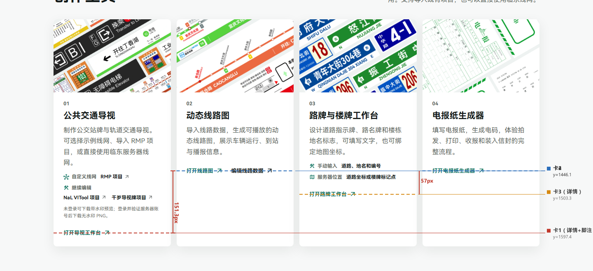
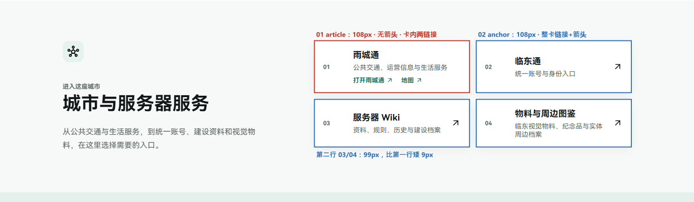
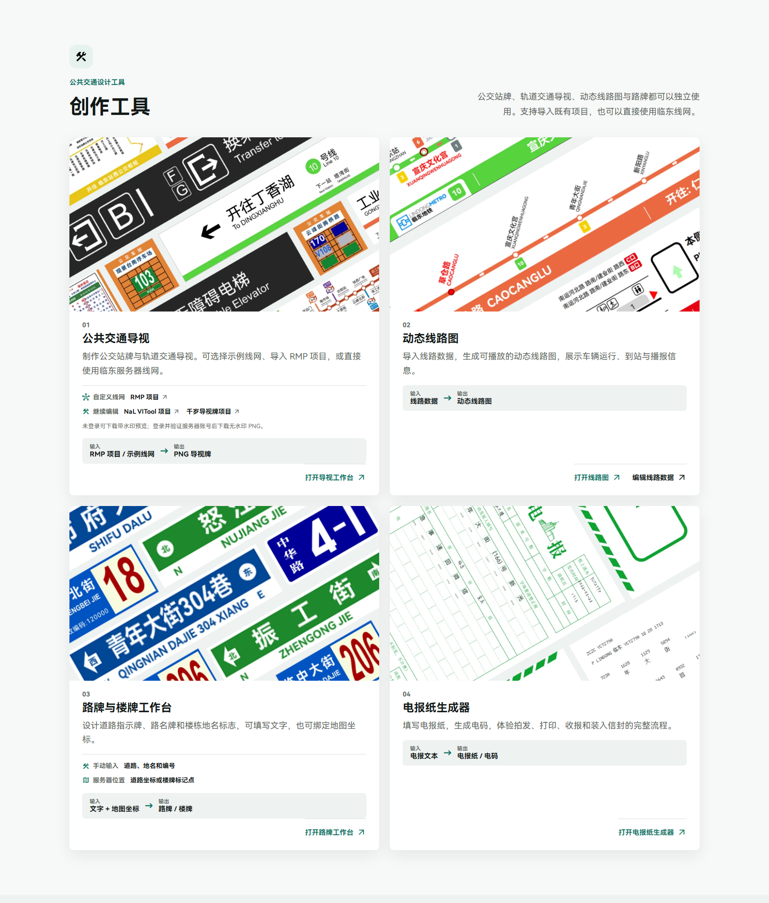
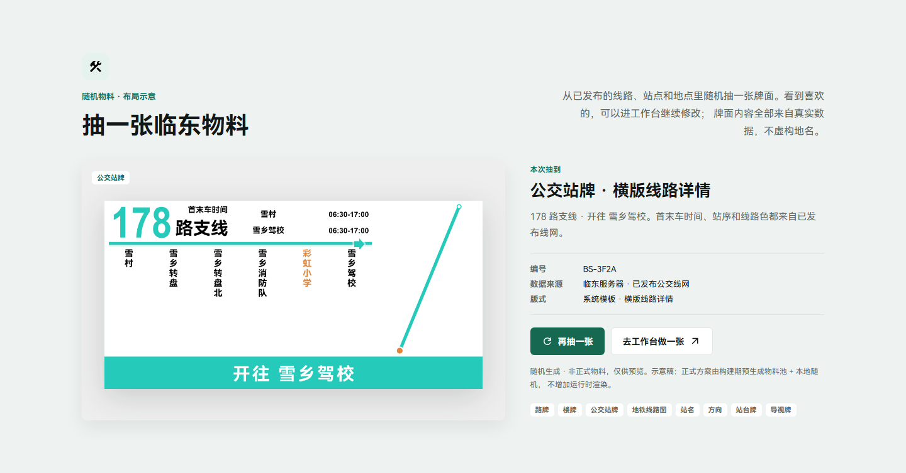
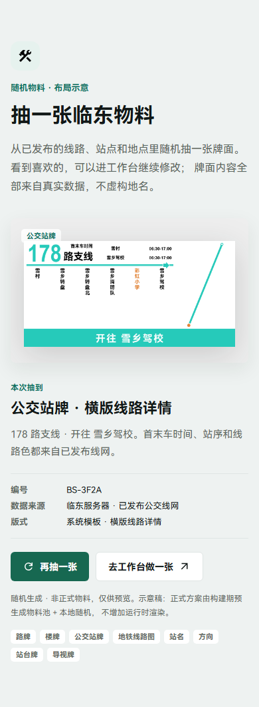

# 门户引入随机物料区块与模块布局优化评估

更新时间：2026-11-27
状态：评估结论，未改动 `apps/portal` 生产代码；文中示意稿只用于验证布局结构。
后续决策（2026-11-27）：随机出图目前只存在于 QQ 机器人侧，**随机物料区块需求暂缓、不排期**；本报告保留备查，布局部分结论不受影响。
范围：`apps/portal` 门户页（`https://shangxiaoguan.top/`）新增“抽取随机物料”章节/区域，以及现有模块布局优化。
前置澄清：本次讨论的前提是**在门户页引入随机物料的展示/抽取区块**，不是把物料渲染能力迁移到门户，也不改变 QQ 机器人物料链路。

## 0. 结论摘要

**随机物料区块：可行，推荐“构建期预生成静态物料池 + 门户本地随机展示”。**

- 门户是纯静态站，直接上传文件即可部署，不需要 Node 服务（`apps/portal/README.md:3,9-13`）。现有随机物料出图依赖 `sharp`、`@resvg/resvg-js`、本地字体和雨城通服务端数据，无法搬进静态站；而把现有渲染接口直接公开，又与“避免变成公开出图机”的既有设计、和 QQ 机器人共享限流相冲突。
- 预生成方案不增加运行时渲染、不需要新增 CORS/CSP 连接，产物是普通图片和 JSON 清单，和门户现有 `assets/` 体系一致。实测复用现有分享记录离线渲染 4 张真实牌面：单张 PNG 8–42KB、渲染 30–315ms（热进程），长边不超过 1024px；生成 60–120 张的池约 3–8MB，转 WebP 后更小。
- 预计投入 4–6 人日（生成脚本 1.5–2.5 人日、门户区块 1–1.5 人日、定时/发布与文档 1 人日），另需内容合规复核 0.5 人日。
- 不推荐把实时公开渲染接口（4–6 人日）或纯客户端渲染（12–20 人日）作为第一版；前者可作为“必须实时/每日更新”时的二期增强。

**门户布局：可以优化，建议先做低风险收口，再决定是否结构重构。**

- 现有关键问题已可量化：1440 宽下 4 张工具卡的 CTA 基线最大相差 **151.3px**，卡 2/4 底部留白 **175px**；1024 宽仍保持 4 列，卡宽只有 **233.5px**；英文 1440 下卡高 647px、CTA 差 **191.9px**；服务区 01 与 02–04 是两套卡片结构；五个 section 有四种标题外壳。
- 另有明显维护性问题：`portal.css` 约 **436 行**样式没有对应元素（旧 maps、quick-tools、gallery 等），`.tool-card`/hero/媒体查询被重复覆盖；三语字典每种语言约 **210 条**里有约 **96 条**（≈46%）已无引用。
- 低风险收口约 **1.5–2 人日**：统一卡脚、工具区断点改为 ≤1100 收两列、统一 section 标题外壳、服务区同构、友链自适应列数、深色 hero 失败态与死代码清理。结构重构（三原语 + 2×2 或主次卡）约 **3–5 人日**，建议放到第二阶段。
- 新增随机物料区块建议放在 `#tools` 之后（首选并入工具 band 作为第二块，或紧随其后的独立浅色 band），复用统一后的 section/card 外壳，不要新增第 5 套卡片结构。

**推荐实施顺序：**

1. M0：确认文案与内容边界（0.5 人日）；
2. M1：布局低风险收口（1.5–2 人日，可与物料池并行）；
3. M2：物料池生成脚本 + 门户区块（4–6 人日）；
4. M3：运营化（更新频率、发布/回滚、监控与文档，约 1 人日，已含在 4–6 内）。

> 2026-11-27 更新：用户决定随机物料需求先放着（当前随机出图只在机器人侧），M0–M2 暂不排期；布局优化部分仍可作为独立工作推进。

## 1. 范围与现状

### 1.1 门户现状

`apps/portal` 是独立静态站，目录内只有 `index.html`、`portal.css`、`portal.js`、`portal-i18n.js`、`site-config.js`、`legacy-wordpress-redirect.js`、`assets/`，上传即可部署（`apps/portal/README.md:3`）。页面顺序固定为“头图、创作工具、简介、服务、社区、友情链接、页脚”（`apps/portal/README.md:58-60`）。根域 CSP 不在仓库中维护，README 说明现有策略只额外放行了到雨城通的 `connect-src`（`apps/portal/README.md:36-42`）。

当前 1440 宽实测：页面高 3738px，hero 820px，工具区 894px，简介 372px，服务 400px，社区 420px，友链 631px；容器宽度 `min(1180px, 100% - 48px)`，断点只有 880/760/620 和 `max-height:650` 几档（`apps/portal/portal.css:1546,1607,1613,1771`）。

### 1.2 随机物料现状链路

```text
QQ 群指令 → 机器人 signage.mjs（组 kind/dataSource + HMAC 签名）
        → POST /api/qq-bot/materials/render（内部接口，±60s 签名、60 次/分、并发 2、25s 超时）
        → qq-bot-material.ts 抽样真实道路/POI/公交/地铁 + 套用工作台字段
        → material-renderer.ts（resvg + sharp + 本地 HarmonyOS 字体）出 PNG
        → 写分享记录，返回 pngBase64 + /m/{slug}/{shareId} 短链
        → 机器人侧拼 signage 卡片与二维码
```

关键证据：

- 渲染入口是内部签名接口，注释明确“签名正是为了避免变成公开出图机”（`apps/web/app/api/qq-bot/materials/render/route.ts:20-30`，`docs/QQ_BOT_MATERIALS_PLAN.md:321`）。
- 生成器覆盖 22 个系统模板（工作区代码 `apps/web/lib/qq-bot-material.ts:104-146`，文档多处仍写 19，属于已知漂移）；数据来自地图道路/POI 与已发布公交、地铁线网，均在服务端读取。示例线网需要运行时访问 railmapgen 并标注 CC BY-NC-SA 4.0。
- 渲染器依赖 `@resvg/resvg-js`、`sharp`、`node:crypto`、`node:fs/path` 和本地字体（`apps/web/lib/material-renderer.ts:1-7,189-229`）；HarmonyOS Sans SC Regular+Bold 实测约 15.7MB，怀旧金书宋约 15.2MB。
- 手机端二维码落到 `/m/{slug}/{shareId}`，该路由 302 到工作台载入字段，并不是一个“看图页”（`apps/web/app/m/[slug]/[shareId]/route.ts:14-41`）。分享图接口 `/api/materials/share-links/{shareId}/card` 可以匿名 GET，但返回 `no-store` 且不带 CORS（`apps/web/app/api/materials/share-links/[shareId]/card/route.ts:115-121`）。
- 分享记录保留 30 天、压缩为 stub 后再保留约 395 天，完整记录上限 2 万条（`apps/web/lib/material-share-link-workflow.ts:57-62`）。

## 2. 随机物料区块方案

### 2.1 方案对比

| 方案                       | 做法                                | 改哪里                                                  | 工作量         | 主要风险                                                          | 体验                   |
| -------------------------- | ----------------------------------- | ------------------------------------------------------- | -------------- | ----------------------------------------------------------------- | ---------------------- |
| A 仅入口                   | 门户加一张卡，跳到雨城通工作台      | 门户 HTML/CSS/i18n                                      | 0.5–1 人日     | 雨城通没有网页随机页，等于没有“抽”的体验                          | 不满足本次诉求         |
| A+ 雨城通新增随机页        | 在雨城通做网页随机页，门户只做入口  | 雨城通新页面 + 匿名限流 + 门户卡片                      | 3–4.5 人日     | 与机器人共用单实例渲染；入口不在门户                              | 好，但离开门户         |
| **B 门户调公开 API**       | 新增只读公开接口，门户实时请求出图  | 雨城通公开路由 + CORS + IP 限流 + 门户 fetch/回退 + CSP | 4–6 人日       | 打开公开出图面；1s/张 CPU；与机器人共享并发 2；每次抽都写分享记录 | 好，但运维成本高       |
| **C 预生成静态池（推荐）** | 构建/定时批量出图，门户本地随机展示 | 生成脚本 + 门户区块 + 定期重生成与发布                  | **4–6 人日**   | 新鲜度靠重生成；门户资源增加；人工上传纪律                        | 好，秒开、零运行时 CPU |
| D 纯客户端渲染             | 把抽样 + SVG/字体/光栅化搬到浏览器  | 重写数据与渲染链路                                      | **12–20 人日** | 数据、字体、导视牌图标、letter-spacing 一致性、长期双实现漂移     | 中，且与工作台不一致   |

补充说明：

- B 的现成可复用模式是 `/api/v1/public/*` 的统一 CORS/缓存封装（`apps/web/lib/public-api.ts:54-73`）；`/api/map/random-poi` 虽然也是公开随机接口，但路由内既没有 CORS 也没有限流（`apps/web/app/api/map/random-poi/route.ts:19-73`），不能直接照搬。
- D 的“可运行”部分是真实的：`material-svg.ts` 明确是同构实现（`apps/web/lib/material-svg.ts:12-18`），工作台已经在浏览器里合成 SVG 预览（`apps/web/components/material-studio-panel.tsx:91,96`）。但导视牌图标在浏览器素材里会直接抛错（`apps/web/lib/material-glyph-browser-assets.ts:61-72`），抽样数据与字体仍在服务端，光栅化还要另写 canvas 方案；综合成本最高，不建议。
- 如果未来确实需要“每次都不一样”的实时结果，再加 B；第一版用 C 就够。

### 2.2 推荐方案 C 的设计

**产物**

- 图片：PNG 原始出图为 ≤1024px 长边、8–42KB；建议统一转 WebP（门户现有头图/封面已使用 WebP，浏览器兼容性一致），并保留原 PNG 作为生成中间物。
- 清单：`apps/portal/assets/materials/manifest.json`，字段建议：
  - `id`、`kind`、`kindLabel`、`templateId`、`templateTitle`、`slug`、`seed`、`code`；
  - `image`（相对路径）、`width`、`height`、`aspectRatio`、`alt`；
  - `source`（`server`/`sample`）、`licenseName`、`licenseUrl`；
  - `createdAt`、可选 `shareUrl`（如果预建分享短链）。
- 规模：首版 60 张（覆盖 8–10 类牌面、每类若干张），体积约 3–8MB；如按现有 22 模板全量生成，建议每个模板 3–5 张、控制在 120 张内。
- 内容范围：首版只取服务器公开数据（道路、POI、已发布公交/地铁线网）；沈阳示例线网只在确认非商用与署名可接受后加入，并固定显示“沈阳示例线网 · CC BY-NC-SA 4.0 · railmapgen.org”。

**生成方式**

- 新增 `scripts/generate-portal-materials.mjs`（或 `.ts`），直接复用 `renderQqBotMaterial` / `renderMaterialTemplateToPng`，在部署机或本地有数据与字体的环境执行：
  - 按模板族与种子批量生成；用 `previewQqBotMaterialSampling` 预检覆盖情况（现有 `pnpm qqbot:material:preview` / `audit` 脚本可参考）；
  - 对每张图做去重（同模板同对象不重复）、尺寸/体积校验（现有校验脚本已断言长边 ≤1280、≤300KB）；
  - 输出前检查许可字段、标题与来源，避免“无来源图片”。
- 实测参考：本地复用已有分享记录离线渲染 4 张（公交站牌横版线路详情、地铁站名旧版、站台站名标志、道路路名方向牌），耗时 30–315ms/张、PNG 8–42KB，说明脚本批量 60–120 张在分钟级可完成。

**门户区块**

- 位置：`#tools` 之后、`#story` 之前。首选并入 `#tools` 同一 band 作为第二块（免去新增一段 84px 的上下留白），或作为紧随其后的独立浅色 band；不放在 story/services 之后，避免打断“工具 → 内容”的连续语境。
- 结构（示意稿已验证）：
  - 标题沿用统一后的 `section-heading-row`：左侧 symbol + kicker + h2，右侧一句说明；
  - 主体为横向 showcase：左侧牌面预览（固定 3:1 或 16:10 媒体框 + `object-fit: contain` + `--tool-media-surface` 底色 + 类型徽标），右侧信息列（“本次抽到” + 物料标题 + 一句话说明 + 编号/来源/版式/许可 + 主操作“再抽一张” + 次操作“去工作台做一张”）；
  - 底部一行“可抽到的类型”标签，沿用 `.content-language-badge` 一类的小徽标语言；
  - 桌面整行 1180px，高约 400–500px（不含标题）；移动端上下叠放，按钮 44px 高；
  - 牌面比例不统一时按宽/方/高三种版式切换媒体框，或在池里只保留横向牌面，首版建议后者更简单。
- 交互：
  - 页面加载抽一张（`crypto.getRandomValues`，复用 hero 的随机方式，并可 `localStorage` 排除上一张）；
  - “再抽一张”本地切换，预加载下一张避免闪白；
  - 不请求任何后端；断网/图片缺失时显示静态兜底图 + 工作台链接；
  - 不加入“盲盒”等营销词，使用“随机物料/抽一张”；
  - 三语 key 全部进 `portal-i18n.js`；模板标题与牌面内容为简体中文，按 README 既有约定显示“简体中文”徽标；
  - 增加 `aria-live` 播报“本次抽到”，牌面 alt 按类型描述；
  - 新增的点击入口沿用 `data-entry-id` / `data-entry-group`，group 建议新增 `materials`，并同步 `events.d.ts`、`docs/EVENT_SCHEMA.md`、`apps/portal/README.md` 的事件清单（目前没有统计监听器，不新增网络上报）。
- 合规声明：
  - 固定显示“随机生成 · 非正式物料，仅供预览”；
  - 与首页“登录并验证服务器账号后可下载无水印 PNG”不冲突，但必须在区块内说明“这里的预览图不是正式导出”；
  - 示例线网必须署名许可；备案信息、网站名“个人学习网站”和页脚 ICP 展示不动（`apps/portal/README.md:5`，`index.html:11-15,774-795`）。

**更新与发布**

- 首版最简单：**跟发版更新**（每次发版重新生成 60 张，统一随门户静态文件上传）；如果希望内容更常换，再加每周任务重生成 + 人工上传。
- 更“自动”的二期：把图片与清单放到雨城通静态目录，门户只拉清单 JSON（需要 CORS + 根域 CSP `connect-src` 到 yct）；这会重新引入跨域和部署顺序问题，不建议首版做。
- 注意：改动门户会改变仓库发布指纹，构建产物校验要求先准备发布记录（`scripts/release-manifest.mjs` 的 `getSourceFingerprint`，`scripts/web-build-artifact.ps1` 的 `YCT_REQUIRE_PREPARED_RELEASE`），发布前要按现有流程跑 `pnpm release:prepare --amend --theme portal --change "..."`。
- `scripts/generate-portal-lqip.mjs` 目前只处理 hero/tools 的 LQIP；新目录如需 LQIP 要扩展脚本，首版可以直接用 WebP 原图。

**分享/回跳的两种取值**

- 只提供“去工作台做一张”：按物料类型跳到路牌或导视工作台，成本最低。
- 要求“编辑这一张”：需要在生成阶段预建分享记录（30 天有效、2 万条上限、stub 清理），清单里带 `shareUrl`，并考虑为门户新增 `origin: 'portal'` 与后台筛选；这会增加存储治理与周更要求，建议放到下一阶段。

### 2.3 不建议的路径（硬阻塞）

| 做法                                           | 为什么不做                                                                                                                                                        |
| ---------------------------------------------- | ----------------------------------------------------------------------------------------------------------------------------------------------------------------- |
| 门户直接调 `POST /api/qq-bot/materials/render` | 需要 HMAC secret；把 secret 放静态页面等于公开出图机，直接破坏现有设计（`render/route.ts:20-30`，`QQ_BOT_MATERIALS_PLAN.md:321`）                                 |
| 门户实时调新公开渲染接口（B）作为第一版        | 单张约 0.8–1.2s CPU、进程内 60 次/分与并发 2 和 QQ 机器人共用；服务器只有 2 核 4G（`docs/DEPLOYMENT.md:626` 附近）；还要处理 CORS、CSP、预检、429、审计与分享记录 |
| iframe 嵌入雨城通工作台                        | 需要对方页面允许被嵌入，且体验/尺寸/移动端都不像门户组成部分，还会引入登录态和 CSP 复杂度                                                                         |
| 客户端重写渲染（D）                            | 数据、字体、图标、光栅化和两套渲染一致性都要重做，12–20 人日；`@resvg/resvg-js`/`sharp` 是原生模块，不能进静态站（`apps/web/next.config.mjs:30-31`）              |
| 公开页用“盲盒”做营销词                         | 公开页面用词应更稳妥；建议只用“随机物料”“抽一张”                                                                                                                  |
| 在门户复制编辑器                               | 编辑、高清、审核仍应唯一留在工作台，门户只做预览与导流（`docs/QQ_BOT_MATERIALS_PLAN.md:27-31,451-457`）                                                           |

### 2.4 里程碑与验收

| 阶段 | 内容                   | 产出                                         | 验收                                                                                    |
| ---- | ---------------------- | -------------------------------------------- | --------------------------------------------------------------------------------------- |
| M0   | 定位/文案/内容范围确认 | 区块文案（三语）、许可与免责声明、池内容范围 | 产品与合规确认                                                                          |
| M1   | 生成脚本 + 首批池      | `manifest.json` + 图片 + 校验脚本            | 覆盖 8–10 类；单张 ≤1024px、≤300KB；字段完整；无虚构名称                                |
| M2   | 门户区块               | HTML/CSS/JS/i18n + 事件 contract             | 1440/1024/768/390 × 明暗 × 三语；无 JS 错误；无横向溢出；按钮 ≥44px；图片加载失败有兜底 |
| M3   | 更新与发布             | 定时任务或发版步骤、上传说明、回滚说明       | 重新生成一次可复现；发布后抽查图片与清单一致                                            |

## 3. 门户布局评估

### 3.1 现状结构

| 模块       | 结构                                  | 1440 实测 | 说明                       |
| ---------- | ------------------------------------- | --------- | -------------------------- |
| hero       | 全幅头图 + 左文案 + 搜索 + 底部地点条 | 820px     | 首屏信息密度高，地点条贴底 |
| 创作工具   | 4 列等宽卡，卡内结构各不相同          | 894px     | 4 张卡 285×553px           |
| 简介       | 左标题右正文，无 symbol               | 372px     | 与其它 section 外壳不同    |
| 服务器服务 | 左介绍（sticky）+ 右 2×2 列表         | 400px     | 01 与 02–04 两套卡         |
| 加入临东   | 左文案 + 右社交链接 2 列              | 420px     | 副标题/文案长度会改变卡高  |
| 友情链接   | 3 列 8 项                             | 631px     | 固定 3 列，末行空 1 格     |

### 3.2 问题清单

**P0：工具卡 CTA 漂移，且 1024 仍强行 4 列**

- 1440 宽：4 张卡外高都是 553px，但 CTA 距卡底分别为 24 / 175 / 118 / 175px，最大差 **151.3px**；1024 宽差 **174.9px**；英文 1440 下卡高 647.3px，差 **191.9px**。根因是 `.tool-card` 的网格行在 `portal.css:2197-2204` 被覆盖为 `grid-template-rows: none; align-content: start`，`.card-actions` 的 `margin-top: auto`（`portal.css:887-895`）因此失效。
- 1024 宽仍在 `@media (max-width: 880px)` 之上，所以卡宽只有 **233.5px**，正文约 15 字/行；从 4 列到 2 列的切换点 880px 太晚，1024–1180 是最常见笔记本宽度却最挤。

证据图：[evidence-before-tool-footer-drift.png](assets/portal-layout-eval/evidence-before-tool-footer-drift.png)


**P1：服务区两套结构**

- 01 雨城通是 `article`（卡内两个文字链接、无箭头、无整卡 hover），02–04 是整卡 `<a>`（有箭头和 hover）；1440 下 01 高 108px、其余 99px，390 下为 108/92，英文 390 下为 125/92/125/147。
- 结果：同一条“服务列表”里混着两种交互语言，行高也不齐。

证据图：[evidence-before-services-structure.png](assets/portal-layout-eval/evidence-before-services-structure.png)


**P1：章节标题四种外壳，起跑线不齐**

- 工具/友链用 `section-heading-row`（左标题 + 右 intro），简介用 `section-heading`（无 symbol、无 intro），服务用 `service-intro`（sticky），社区用 `community-copy`。
- h2 距 section 顶部：简介 114px、工具/友链 176px、服务/社区 190.8px；左栏宽度 464/438/466px、gap 88/84/84px 各处不同。

**P1：友链固定 3 列，8 项末行空 1 格；复制链接与整卡链接混排**

- `.friend-links` 固定 `repeat(3, minmax(0,1fr))`（`portal.css:1193-1196`），8 项必然留 385px 空位；失效链接用按钮、正常链接用 `<a>`，同一区域两种交互；部分“不活跃”标签折到第二行。

**P1：移动端无站内导航，触控目标偏小**

- ≤620px `.header-nav` 整体隐藏（`portal.css:1655-1657`），用户只能靠页脚和区块顺序；语言按钮 31×32px（`portal.css:1663-1666`），卡片动作文字链只有约 18px 高，不满足 DESIGN.md 的 44px 触控约定。

**P2：深色 hero 失败态与随机头图可读性**

- `.hero` 背景用 `var(--ink)`（`portal.css:229-236`），深色模式下 `--ink` 变成 `#edf4f0`（`portal.css:1486-1497`）；如果头图加载失败，白色 hero 文案和 70% 白说明文字对比度只有约 1.08:1。
- 15 张随机头图里有 7 张在说明文字区域 p95 对比度低于 4.5:1，二次访问换图时可读性不稳定；主图安全，但无法保证每张都安全。

**P2：样式与多语维护性**

- `portal.css` 约 **436 行**没有对应元素：旧 `.maps` 规则（918–1121）、旧首页改版的 `.quick-tools`/`.gallery`/`.city-gallery`/`.search-section`（1910–2195）等；`.tool-card` 定义两次、hero 高度定义四次，同一媒体查询出现多个重复块。
- 三语字典每种约 210 条，约 **96 条**无引用（`maps.*`、`search.*`、`ask.*`、`quickTools.*`、`heroPlace.*`、`story.paragraph2` 等），是旧改版回滚后的残留。
- 英文下版面不守恒：1440 工具卡高 647px（中文 553px）、服务行高 147px（中文 99px）；390 英文首屏 799px 占 95% 视口，CTA 折行、搜索占位被截断。多语只靠局部 `html:lang(zh-CN)` 隐藏 badge 之类补丁，没有结构层面的约束。

### 3.3 根因

1. **没有共享布局原语**：每个模块各自定义 section 外壳、标题、卡片和卡脚，导致 5 个模块 4 种标题、工具卡 4 种内部结构、服务卡 2 种结构。
2. **HTML 换新、CSS 尾部追加**：旧模块样式不删除，新规则在后面覆盖，形成覆盖链和死代码；改一处容易漏另一处。
3. **对称网格承载不等量内容**：4 列等宽卡里，一个卡片可能多出详情行、脚注或双动作，只靠 `min-height` 撑高度，没有给 footer 预留行；卡脚因此漂移。
4. **断点、触控、多语靠局部补丁**：880/760/620 + `nth-child` 隐藏导航 + 语言专属隐藏 badge，缺少与内容长度无关的约束（clamp、auto-fit、固定槽位）。

### 3.4 优化方案

#### 3.4.1 低风险调整（1.5–2 人日，CSS 为主）

| 改动               | 做什么                                                                                                                                                | 收益                                              | 风险                                                        |
| ------------------ | ----------------------------------------------------------------------------------------------------------------------------------------------------- | ------------------------------------------------- | ----------------------------------------------------------- |
| 工具卡卡脚         | 恢复 `.tool-card` 的 `display:flex; flex-direction:column` + `.card-actions{ margin-top:auto }`（或恢复 1fr 行），并给四张卡补统一的“输入→输出”信息带 | 消除 151–192px 的 CTA 漂移和卡底留白；卡脚可预期  | 低；需按 1440/1024/768/390 × 三语回归                       |
| 工具区断点         | 4→2 列提前到 ≤1100px，2→1 保持 620px；必要时给卡宽上限                                                                                                | 1024 不再 4 张窄卡；桌面保持 4 列、页面不显著变长 | 低                                                          |
| 标题外壳           | 全站统一 `section-heading-row`（左 symbol+kicker+h2，右 intro）；简介补 symbol 或统一去掉                                                             | 五个 section 起跑线与右栏文案一致                 | 低；简介的 phrase-title 需要保留两段换行                    |
| 服务区同构         | 01 改成与 02–04 同构的整行链接（带箭头）；雨城通的“地图”作为行内次链接保留                                                                            | 去掉两套卡语言和 9px 行高差                       | 低；需确认整卡点击与次链接的嵌套关系                        |
| 友链自适应         | 改为 `auto-fit minmax(260px,1fr)`，8 项不再留空；复制按钮与链接卡统一外形                                                                             | 末行断裂消失，交互语言统一                        | 低                                                          |
| 深色 hero 与死代码 | hero 背景固定深色，不跟随 `--ink`；说明文字提亮；删除 436 行死 CSS、合并重复媒体查询                                                                  | 图片失败态可读；后续改动不再踩覆盖链              | 低–中；需要像素回归阈值（沿用既有 CSS 拆分计划的 <1% 方法） |

4 列保留 + 卡脚对齐的示意：[after-tools-4col-1440.png](assets/portal-layout-eval/after-tools-4col-1440.png)

建议同批顺手做但可分离：语言按钮和卡片动作链补到 44px 触控高度；移动端补一个“页面导航”折叠入口。这两项属于可用性，不是纯布局。

#### 3.4.2 结构重构（3–5 人日，HTML+CSS）

先定义三个原语：

- `.section-shell`：band、最大宽、标题槽（symbol/kicker/h2）、intro 槽；
- `.card-shell`：媒体、标题、描述、meta 槽、统一 `.card-foot`；
- `.action-footer`：主动作 + 次链接，固定在卡脚。

间距只用 4–6 个变量，圆角/阴影收敛到 2–3 档。工具区两个可选方案：

- **方案 A：2×2 等宽卡**（≥720px 两列、<720 单列）。媒体 16:9、描述 3 行、卡脚对齐。优点是四张图都变大、结构最统一；代价是工具区从 894px 增到约 1600px，整页变长。
- **方案 B：主次卡**。动态线路图作为主工具占 2 列大卡，其余 3 张为紧凑行卡，统一卡脚。这更贴合 README 里“动态线路图是主工具，其余是卡内配套入口”的定位（`apps/portal/README.md:50`）；代价是需要重排 HTML 和英文文案。

示意稿（2×2）：[after-full-2x2-1440.webp](assets/portal-layout-eval/after-full-2x2-1440.webp)


回归矩阵：1440/1024/768/390 × 浅/深 × zh-CN/zh-Hant/en，重点检查 scrollWidth 无横向溢出、CTA 基线一致、标题起跑线一致、英文不折行溢出；用本次审计脚本（`tmp/portal-layout-audit/shoot.mjs`、`probe.mjs`）复跑做像素对照。

### 3.5 新增随机物料区块的落位与结构规范

- **位置**：`#tools` 之后、`#story` 之前；首选并入工具 band 作为第二块（省掉新增一段 band 的上下留白），或紧随其后的独立浅色 band。
- **标题**：复用统一后的 `section-heading-row`，kicker 用“随机物料”，h2 用“抽一张临东物料”一类表述，右侧 intro 说清“来自真实数据、可去工作台继续改”。
- **主体**：横向 showcase，而不是第 5 套卡结构：
  - 左：牌面预览（媒体框 + contain + 中性底色 + 类型徽标）；
  - 右：信息列（本次抽到/标题/一句话/编号·来源·版式/许可）+ 统一 `.action-footer`（“再抽一张”主操作 + “去工作台”次链接）；
  - 下：类型标签行（路牌/楼牌/公交站牌/地铁线路图/站名/方向/站台牌/导视牌）；
  - 移动端上下叠放，按钮 44px。
- **比例处理**：池里优先收横向牌面（2:1、4.5:1、6:1 等），统一 3:1 媒体框；方牌（1:1）和竖版（1:2.5）可单独用方框/竖框样式，或在首版不放进池里。
- **状态**：加载中显示占位底色；图片失败显示静态兜底图与链接；`aria-live` 播报结果；不写 cookie、不发网络请求。
- **与布局优化的关系**：先完成 3.4.1 的标题外壳和卡脚收口，再插入这个区块，避免它变成第 5 套结构；否则后续结构重构还要再改一次。

示意稿：




深色模式下的区块示意：[after-materials-dark-1440.png](assets/portal-layout-eval/after-materials-dark-1440.png)。移动端整页示意：[after-full-4col-390.webp](assets/portal-layout-eval/after-full-4col-390.webp)。

完整页面示意（4 列保留 + 统一卡脚 + 随机物料区块）：[after-full-4col-1440.webp](assets/portal-layout-eval/after-full-4col-1440.webp)
工具区前后对照：[comparison-tools-1440.png](assets/portal-layout-eval/comparison-tools-1440.png)

### 3.6 工时与优先级

| 优先级   | 工作                                  | 工时       | 说明                     |
| -------- | ------------------------------------- | ---------- | ------------------------ |
| P0       | 工具卡卡脚 + ≤1100 断点               | 0.5–1 人日 | 收益最大、风险最低       |
| P1       | 标题外壳 + 栅格/间距收敛              | 约 1 人日  | 给新模块提供统一模板     |
| P1       | 服务区同构 + 友链自适应               | 约 1 人日  | 去掉两套卡语言与末行空位 |
| P2       | 深色 hero、死 CSS/字典清理、i18n 卡高 | 1–2 人日   | 可拆到后续迭代           |
| 结构重构 | 三原语 + 方案 A/B                     | 3–5 人日   | 视 P0/P1 效果再决定      |
| 随机物料 | 池生成 + 门户区块 + 运维              | 4–6 人日   | 可与布局低风险并行       |

推荐第一批一起做：P0 + 标题外壳 + 服务区同构（约 2–3 人日），第二批次做随机物料区块（4–6 人日），结构重构作为可选第三批。

## 4. 决策点

1. **区块定位**：只做“随机预览 + 导流”，还是允许“编辑这一张”？前者 4–6 人日，后者要预建分享记录、处理 30 天过期与 2 万条上限。
2. **内容范围**：只放临东服务器真实数据，还是也放沈阳示例线网？后者需要 CC BY-NC-SA 4.0 署名和非商用判断。
3. **池更新方式**：跟发版更新（最简单），还是每周/每日定时重生成（需要任务计划与上传流程）？是否接受不是“实时随机”？
4. **布局档位**：第一批只做低风险收口，还是同时做结构重构？工具区保持 4 列、改 2×2，还是主次卡？
5. **移动端与可用性**：是否把移动导航、44px 触控、深色 hero 一起纳入本批？

## 5. 评估方法与证据

- 方法：Edge headless + CDP 整页截图（1440/1024/768/390、明暗、三语）、DOM 几何量测、CSS 逐行阅读；现有门户未修改。
- 离线出图验证：复用 `apps/web/.yct-data` 与 `.yct-data/material-share-links.json` 中的真实分享记录，用 `renderMaterialTemplateToPng` 渲染 4 张真实牌面（日志见评估过程），确认 PNG 体积、尺寸与耗时，未发起外部网络请求。
- 示意稿：复制 `apps/portal/index.html` 加覆盖样式，插入随机物料区块与卡脚改造，用本地静态服务 + CDP 截图；所有示意文件在 `tmp/portal-mock/`，图片证据已收纳到 `docs/assets/portal-layout-eval/`，**不是最终视觉稿**，也没有进入生产代码。
- 已知限制：未在真机、Safari、弱网环境验证；未接入生产数据重新生成完整池；没有改动 CSP、Nginx、发布流程，因此上线前仍需按现有部署流程做一次真实环境验收。

## 6. 参考

- `apps/portal/README.md`：静态部署边界、CSP、结构顺序、多语言、事件。
- `apps/web/app/api/qq-bot/materials/render/route.ts`：内部签名渲染接口。
- `apps/web/lib/qq-bot-material.ts`、`material-renderer.ts`、`material-svg.ts`、`system-material-templates.ts`：抽样、渲染与同构 SVG。
- `apps/web/lib/material-share-link-workflow.ts`：分享记录 30 天/2 万条/395 天规则。
- `apps/web/lib/request-site-url.ts`：分享链接 Origin 推导（门户调用时必须注意域名）。
- `docs/QQ_BOT_MATERIALS_PLAN.md`：定位、签名理由、限流、性能与分享语义。
- `docs/MATERIAL_TEMPLATE_SOURCE.md`：模板来源、字体与水印/审计边界。
- `DESIGN.md`、`docs/DESIGN_SYSTEM_AUDIT.md`：断点、间距、圆角、触控与现有漂移记录。
- `scripts/portal-tokens.mjs`、`scripts/ui-breakpoints.mjs`、`scripts/release-manifest.mjs`、`scripts/web-build-artifact.ps1`：门户 token 校验、断点校验范围、发布指纹与构建门禁。
