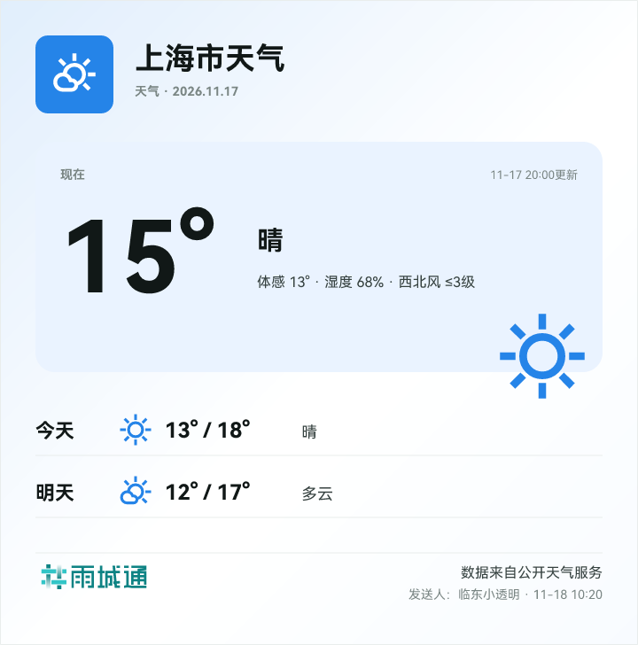

# QQ 机器人快捷指令

更新时间：2026-11-17

这些指令在机器人本地处理，不经过问一问的检索和主问答链路，也不需要网页端提供接口。
代码在 `integrations/qq-bot/src/commands.mjs`，数据在 `integrations/qq-bot/data/`。

群聊里同样要先 @ 机器人。指令可以加 `/`，也可以直接用自然触发词，例如 `计算 1+2`、`上海天气`、`历史上的今天`。

## 指令一览

| 指令        | 示例                                               | 说明                                                               |
| ----------- | -------------------------------------------------- | ------------------------------------------------------------------ |
| `/随机`     | `/随机`、`随机数 10`、`随机数 1-10`、`随机数 1 10` | 默认 1-100；支持上下限、`5-10` 和 `5 到 10` 写法                   |
| `/骰子`     | `/骰子`、`/掷骰子`、`/2d6`、`2个6面骰`             | 不写参数默认 1d6；6 面骰画点数，支持 `3d6+2`                       |
| `/算`       | `/算 (1+2)*3`、`计算 (1+2)*3`、`/算 sqrt(9)+2`     | 四则、乘方、括号、`sqrt/abs/round/floor/ceil`，支持全角数字和 `×÷` |
| `/电码`     | `/电码 临东`、`电码 临东`、`中文电码 临东`         | 中文电码，返回每个字的四位码                                       |
| `/gb2312`   | `/gb2312 临东`、`汉字编码 临东`、`GB2312 临东`     | 返回 GB2312 十六进制码；6 个字以内附带区位码                       |
| `/天气`     | `/天气`、`天气 上海`、`上海天气`、`天气怎么样`     | 不写城市时用 `QQ_BOT_WEATHER_CITY`                                 |
| `/ip`       | `/ip 8.8.8.8`、`查IP 8.8.8.8`                      | 必须带地址；不带地址会拒绝查询，避免泄露机器人出口 IP              |
| `/历史`     | `/历史`、`历史上的今天`                            | 历史上的今天，按上海时区取当天事件                                 |
| `/对联`     | `/对联 春风拂柳`、`对对联 春风拂柳`                | 调用模型只对下联，不输出横批，会产生一次额外的模型调用             |
| `/签到`     | `/签到`、`签到`、`打卡`                            | 每个群每天一次，记录累计次数和连续天数                             |
| `/签到榜`   | `/签到榜`、`签到排行`                              | 本群累计签到前 10 名                                               |
| `/发言统计` | `/发言统计`、`发言统计 7`                          | 今日或最近 N 天的消息条数、参与人数、活跃天数                      |
| `/发言榜`   | `/发言榜`、`发言榜 7`                              | 今日或最近 N 天发言条数前 10 名                                    |
| `/运势`     | `/运势`、`今日运势`、`抽签`                        | 1-100 分 + 一条随机文案，当天固定                                  |
| `/人数`     | `/人数`、`在线人数`、`服务器状态`                  | 读取站内服务器状态；未知时明确提示，不返回 0 人                    |
| `/随机地点` | `/随机地点`、`手气不错`、`随便逛逛`                | 从公开 POI 中随机抽一个，返回地图分享链接和 POI 卡片               |
| `/重置运势` | `/重置运势`、`重抽运势`                            | 重抽当天运势                                                       |
| `/帮助`     | `/帮助`、`菜单`、`功能`                            | 列出这些指令和问一问的用法                                         |
| `/关于`     | `关于机器人`、`/关于机器人`                        | 机器人简介和数据来源                                               |
| `/版本`     | `/版本`、`机器人版本`、`版本`                      | 机器人版本、卡片渲染方式和网页当前 build                           |
| `/新对话`   | `/新对话`、`/new`、`新对话`                        | 清空当前对话上下文                                                 |

未知的 `/xxx` 会提示发送「菜单」，不会当成普通问题交给模型。自然语句只有明确命中上面的句式才会被接管，
像“计算器怎么用”“随机数是多少”“电码是什么”这类问法会继续交给问一问。

## 自然触发词

| 句式                        | 例子                               | 解析规则                                     |
| --------------------------- | ---------------------------------- | -------------------------------------------- |
| 计算【列式】                | `计算 (1+2)*3`、`计算1+2`          | 后面的内容必须含数字或运算符，否则不接管     |
| 随机数【最小值】-【最大值】 | `随机数 1-10`、`随机数 1 到 10`    | 不写范围默认 1-100                           |
| 【地名】天气                | `上海天气`、`上海今天天气`         | 会去掉“今天/明天/现在”等时间词               |
| 天气【地名】                | `天气 上海`、`天气上海`            | 不写地名用默认城市；“天气怎么样”也走默认城市 |
| 对对联【上联】              | `对对联 春风拂柳`                  | 带“怎么/是什么”等问法时交回问一问            |
| 查IP【IP】                  | `查IP 8.8.8.8`                     | 不写 IP 时查询服务器自己的地址               |
| 历史上的今天                | `历史上的今天`                     | 完全匹配才接管                               |
| 汉字编码【文本】            | `汉字编码 临东`、`GB2312 临东`     | 带“是什么”等问法时交回问一问                 |
| 电码【文本】                | `电码 临东`、`中文电码 临东`       | 带“是什么”等问法时交回问一问                 |
| 签到 / 打卡                 | `签到`、`打卡`                     | 每个群每天一次                               |
| 签到榜                      | `签到榜`、`签到排行`               | 本群累计签到前 10                            |
| 发言统计【天数】            | `发言统计`、`发言统计 7 天`        | 天数可省略，默认今天                         |
| 发言榜【天数】              | `发言榜`、`发言榜 7`               | 天数可省略，默认今天                         |
| 今日运势 / 重置运势         | `今日运势`、`重置运势`             | 当天固定，重置后重抽                         |
| 随机地点                    | `随机地点`、`手气不错`、`随便逛逛` | 从公开 POI 随机抽一个                        |
| 菜单 / 功能 / 关于机器人    | `菜单`、`功能有什么`、`关于机器人` | 菜单返回帮助，关于返回简介                   |

## QQ 指令入口适配

QQ 开放平台的机器人指令入口只接受**以 `/` 开头、中间没有空格**的命令名，用户点击后会直接把命令发出来，
不能等待补参数。因此入口里只放“点了就能出结果”的命令：

| 入口命令    | 默认行为                          |
| ----------- | --------------------------------- |
| `/随机`     | 1-100 随机数                      |
| `/掷骰子`   | 默认 1d6，卡面显示骰子点数        |
| `/天气`     | 查询 `QQ_BOT_WEATHER_CITY` 的天气 |
| `/历史`     | 历史上的今天                      |
| `/随机地点` | 随机公开 POI + 分享卡片           |
| `/人数`     | 服务器在线人数；未知时明确提示    |
| `/签到`     | 本群今日签到                      |
| `/签到榜`   | 本群累计签到榜                    |
| `/发言统计` | 今天本群发言统计                  |
| `/发言榜`   | 今天本群发言榜                    |
| `/运势`     | 今日运势                          |
| `/重置运势` | 重抽今日运势                      |
| `/帮助`     | 指令说明                          |
| `/关于`     | 机器人简介                        |
| `/版本`     | 查看机器人版本和网页 build        |
| `/新对话`   | 清空当前对话上下文                |

以下命令需要参数，不要挂到指令入口，否则点击后只会得到用法提示：`/计算`、`/查IP`、`/电码`、
`/gb2312`、`/对联`。其中 `/查IP` 不带地址时现在会直接拒绝，不再查询机器人所在服务器的出口 IP。

## 各功能的实现与外部依赖

### 随机数与骰子

- 使用 `node:crypto` 的 `randomInt`，不使用 `Math.random`。
- 骰子支持 `/掷骰子`、`/掷骰子 2d6`、`/掷骰子 2个6面骰`、`/掷骰子 3d6+2` 和 `/2d6`。
- 不写参数时默认 1d6；6 面骰画点数，4/8/20 面用三角形或菱形，10/12 面用五边形，所有多边形带圆角，其他面数显示数字。
- 骰子数量 1-20、面数 2-1000，避免一次刷出过长的消息。
- 不依赖网络。

### 算式

- 自己实现的递归下降解析器，不调用 `eval` / `Function`。
- 支持 `+ - * / % ^`、括号、一元正负号、`pi` / `e` 和几个常用函数。
- 全角数字、`（ ）`、`×`、`÷`、`−` 会先归一化。
- 除零、括号不闭合、未知函数都会返回可读错误。

### 中文电码

- 数据来自站内电报纸使用的 `apps/web/lib/telegraph-codebook.ts`，生成到 `data/ccc.json`。
- 只收录单字映射；标点也有电码的按表返回。
- 一次最多 40 个字。

### GB2312

- 数据在 `data/gb2312.json`，按 CP936 编码后筛选 GB2312 区间（高位 `A1-F7`、低位 `A1-FE`），并验证能往返解码。
- 输出十六进制码；6 个字以内附带区位码，例如 `临 C1D9（33-57）`。
- ASCII 字符单独返回两位十六进制。
- 不在 GB2312 的字符会单独列出来。

这两个数据文件是静态表，更新时需要和 `src/`、`assets/` 一起复制到服务器。

### 天气

- 天气卡片按当前天气动态换主色：晴为暖金、多云为蓝、雨为深蓝、雪为青蓝、雷为紫；
  负温度、长天气描述和缺失预报都已做兼容。
- 配置了 `QQ_BOT_AMAP_KEY` 时优先走高德天气：
  - 先用 `restapi.amap.com/v3/geocode/geo` 把城市名解析成 adcode；
  - 标题使用解析后的省/市/区，而不是重复用户输入：`浦东天气` 显示 `上海市浦东新区天气`，
    `南京天气` 显示 `江苏省南京市天气`；
  - 再并行请求 `weatherInfo` 的 `base`（实时）和 `all`（预报）。
- 不填高德 Key 时回退到 wttr.in（免费、无需 Key），天气描述由本地代码表翻译；
  wttr 的 `nearest_area` 会显示实际观测点，例如 `上海（浦东，中国）天气`，
  不会只写“上海天气”。
- 需要配置真实城市名：

  ```dotenv
  QQ_BOT_WEATHER_CITY=上海
  QQ_BOT_AMAP_KEY=你的高德 Web 服务 Key
  ```

  “临东市”这类虚构地名查不到，会提示改成真实城市名。

- 高德结果缓存 60 分钟，adcode 解析结果常驻内存；按每月 5000 次额度，正常频率足够用。
- wttr.in 结果缓存 10 分钟。
- 输出当前温度、湿度、风和今明两天的高低温、天气。
- 服务器需要能出站访问 `restapi.amap.com` 或 `wttr.in`。

### IP 属地

- 优先 `ipwho.is`（`lang=zh-CN`，中文国家/省/市），失败回退 `ipapi.co`（英文）。
- 只接受 IPv4 / IPv6；不解析域名，避免 CDN 和 anycast 导致结果误导。
- 不写地址时查询机器人所在服务器的出口 IP。
- 结果缓存 10 分钟。
- 输出示例：`114.114.114.114：中国 江苏省 南京 · China Telecom AS137702`。

### 历史上的今天

- 数据源：百度百科的按月事件 JSON（`baike.baidu.com/cms/home/eventsOnHistory/<月>.json`），中文，无需 Key。
- 按 `Asia/Shanghai` 取月日；优先选 `type=event` 的事件，再补出生/逝世，最多 6 条。
- 标题里的 HTML 标签会被清掉。
- 同一月日缓存 6 小时。
- 如果百度接口不可用或当天没有数据，返回可读错误，不影响其他功能。

### 对对联

- 走 `src/model-api.mjs` 直连模型服务商，和二次精炼共用同一份 Key。
- 同一个 `/对联` 接口同时兼顾普通对联和无情对：提示词优先按无情对处理，要求字面工整、词性相对、语义尽量不相干；如果上联明显是普通对联，也允许兼顾意境。
- **只输出下联，不再生成横批**，适合偶尔玩，不建议刷屏。
- 会产生一次额外的模型调用。

### 签到与签到榜

- 数据保存在机器人本地 JSON（默认 `state/qq-bot-state.json`，可用 `QQ_BOT_STATE_PATH` 改）。
- 按“群 + 用户”记录：累计签到次数、连续天数、最后签到日期；日期按 `Asia/Shanghai`。
- 每天只能签到一次；断签后连续天数从 1 重新开始。
- 签到榜按累计次数排序，最多显示 10 人。

### 发言统计与发言榜

- 机器人收到的 `GROUP_AT_MESSAGE_CREATE` 一定会计数；如果开放平台开通了“接收所有消息”，
  `GROUP_MESSAGE_CREATE` 也会计数（只统计、不回答）。
- 同一条消息重复推送按消息 ID 去重，不会重复计数。
- 统计口径：
  - 次数：消息总条数；
  - 人数：去重后的发言用户数；
  - 天数：统计区间内有发言的天数。
- 默认看今天，`发言统计 7` / `发言榜 7` 看最近 7 天；最多 90 天。
- 消息按天保存，超过 90 天自动清理。
- 没有开通“接收所有消息”时，统计只覆盖 @机器人 的消息，回复里会明确标注这个范围。

### 今日运势

- 分数使用 `crypto.randomInt` 生成 1-100，文案从 `data/fortune-texts.txt` 随机选一条。
- 文案一行一条，可直接编辑；修改后重启机器人。状态里只保存文案索引，改短文件时会自动回退到第一条。
- 按“用户 + 日期”保存；同一天重复查询结果不变。
- `重置运势` 会重抽并覆盖当天结果，方便不满意时换一个。
- 结果只存在机器人本地，不同步到网页账号；仅供娱乐。

### 随机地点

- 调用站内已有的 `/api/map/random-poi`，只从公开、已发布且有几何的 POI 中抽取。
- 文字回复地点名、类型、地址和分享链接；图片卡片显示地点名、描述、地址、营业时间和坐标。
- 分享链接使用 `YCT_PUBLIC_BASE_URL` 拼成完整地址；没配置时退回 `YCT_BASE_URL`。
- 没有封面时使用内置地图渐变占位图；二维码仍会生成。
- 接口返回 404/503 时只发文字提示，不发送空白卡片。

### B 站视频

- 消息里出现 `bilibili.com/video/...` 或 `b23.tv/...` 时，先读视频信息，再发文字和封面海报。
- 文字包含标题、UP 主和标准视频链接；海报使用视频封面，走 QQ 富媒体上传。
- 通过 `QQ_BOT_BILIBILI=0` 可以关闭，关闭后链接会交回问一问处理。
- B 站接口失败时不会拦截消息，仍按普通问题回答。

### 群进退群提示

- 文案在 `data/group-notices.json` 按群配置，支持 `welcome`、`kick`、`leave`。
- 支持 `{name}`、`{id}`，也兼容旧文案里的 `【发送者名片】`、`【发送者QQ】`、`【艾特】` 和 `【换行】`。
- 官方 QQ 机器人不保证下发普通成员进退群事件；未下发时需要 OneBot/群管事件桥接。

### 回答配图（可选）

- 问一问的运营内容引用可能带 `imageUrl`（运营封面）。
- 配置 `YCT_PUBLIC_BASE_URL` 为站点的 HTTPS 公网地址、并保持 `QQ_BOT_IMAGES=1` 时，
  机器人会先上传封面，再发送文字回答，最后补一张图片消息。
- 群聊里的图片走**主动消息**（不带 `msg_id` / `msg_seq`），不会让文字回答再 @ 发起者一次；
  单聊仍走普通被动图片。
- 不再使用 Markdown 图文消息：手机 QQ 只显示 `[封面]` 文本，兼容性不可靠。
- 图片必须是 HTTPS，且域名在 `YCT_PUBLIC_BASE_URL` 或 `QQ_BOT_IMAGE_HOSTS` 内。
- 上传失败只发纯文字；主动图片发送失败只写日志，不影响已发送的文字。

### 指令结果卡片

除 **签到、帮助、关于机器人、新对话** 外，其余本地指令都会附一张 720px 宽的 PNG 卡片，包括：

- 随机数、骰子、算式、中文电码、GB2312；
- 天气、IP 属地、历史上的今天、对对联、随机地点；
- 签到榜、发言统计、发言榜、今日运势、重置运势。

群聊里卡片先作为**主动图片**发送，再发被动文字回复；图片不带 `msg_id`，所以整轮只 @ 发起者一次。
单聊则是文字后附卡片图片。

卡片版式对齐地图分享卡片 `.map-share-preview`：

- 白色底、主题色淡面性色块，不再给灰色面板加细描边；
- 顶部主题色图标块直接使用 **Material Symbols** 图标（中文电码用自绘莫尔斯符号），
  标题/眉题显示关键词（如“上海天气”“1-10随机数”“(1+2)*3”）；
- 底部直接使用站内 `yct-logo-wordmark.svg` 字标，右侧两行显示来源、发送人和发送时间；
- 颜色和正文字体沿用站点设计 token / HarmonyOS Sans SC。

各类结果分别处理：

- 随机数、骰子、算式、IP 属地：大字号结果面板，去掉左侧竖线；
- 天气：仿天气 App，大号当前温度 + 天气图标 + 今明两天；
- 中文电码：直接使用提供的绿色电报纸行 SVG，每个汉字格下面直接放该字的四位码；
- GB2312：直接使用提供的红色答题卡行 SVG，**一行 3 个字**，每个字从上到下依次是
  汉字、四位十进制区位码（每位一个小格）、0-9 涂卡气泡；选中的数字上盖黑色短横线，最多展示前 6 个字；
- 今日运势：黄色分数圆环 + 吉凶 + 签文；
- 对对联：红纸竖排上联/下联，字更大、底色更浓；上联/下联标签竖排放在红纸两侧；只对下联，不生成横批；
- 发言统计：三个大数字指标 + 统计范围；
- 签到榜/发言榜：排名列表；
- 只有历史保留少量 chip，其余卡片不再铺 chip。

实现细节：

- 渲染地址是网页端的 `/api/qq-bot/card`，机器人把卡片数据 base64url 后放进 `d` 参数；
- 需要 `YCT_PUBLIC_BASE_URL`、`QQ_BOT_CARDS=1`，且网页端已部署该路由；
- 图片会占用一次被动回复序号；渲染或上传失败只写日志，不影响文字回复。

示例：




更多：[签到榜](assets/qq-bot-cards/signin-board.png)、[发言统计](assets/qq-bot-cards/stats.png)、
[发言榜](assets/qq-bot-cards/board.png)、[算式](assets/qq-bot-cards/calc.png)、
[IP 属地](assets/qq-bot-cards/ip.png)。

## 与问一问的关系

- 指令在 `bot.mjs` 里先于问一问处理：命中 `/` 指令就直接回复，不进入检索、工具调用和主问答。
- 不读账号、不读页面上下文，也不会把指令写进对话历史。
- 指令回复同样受 QQ 被动回复规则限制：群聊 5 分钟/5 次、单聊 60 分钟/4 次。
- 目前指令没有单独限流；如果担心 `/对联` 被刷，可以在反向代理或 `bot.mjs` 里按用户加限流。

## 部署注意

- 新增了 `data/` 和 `state/` 目录，更新时把 `src/`、`data/` 和 `.ps1` 一起复制到服务器，保留 `.env` 和 `state/`。
- 不需要安装依赖，仍然只需要 Node.js 22+（当前部署 Node 24）。
- 天气和 IP 需要服务器出站访问对应 API；历史数据需要访问百度百科。若服务器网络受限，对应指令会返回错误，不影响问一问。
- 配图需要 `YCT_PUBLIC_BASE_URL` 是 QQ 能访问的 HTTPS 公网地址；`127.0.0.1` 或内网地址会被跳过。
