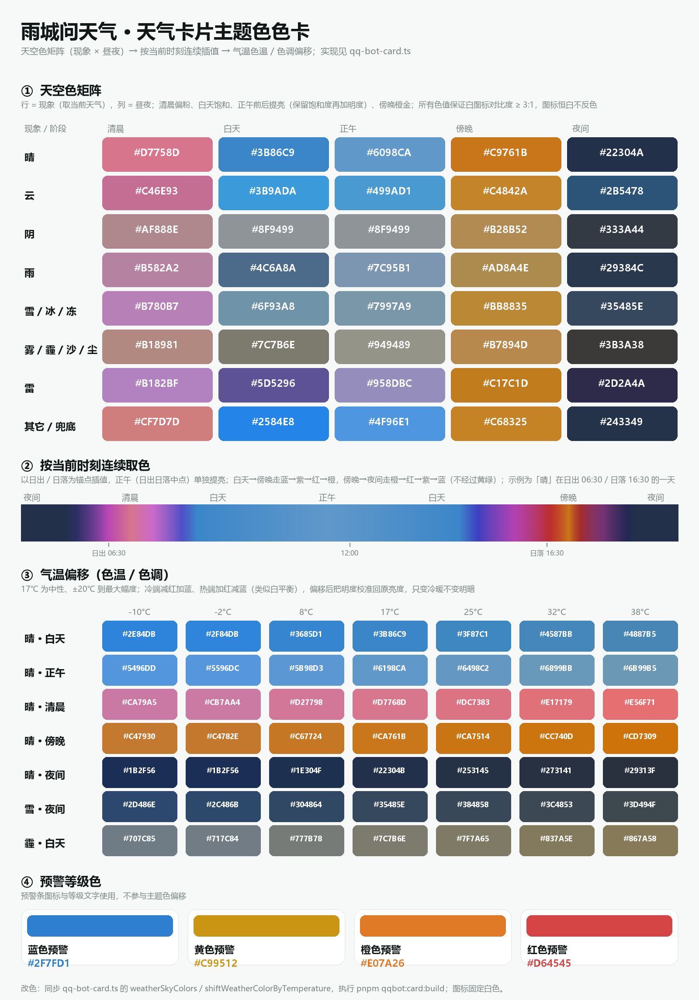
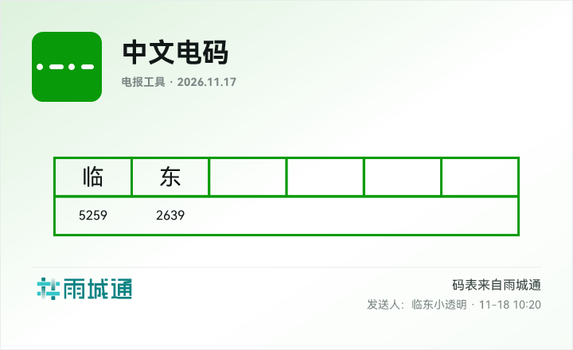
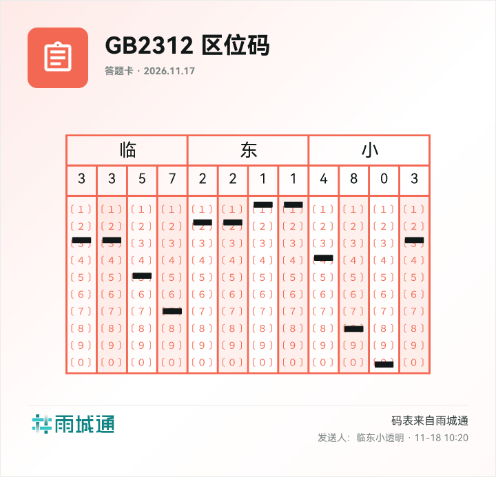
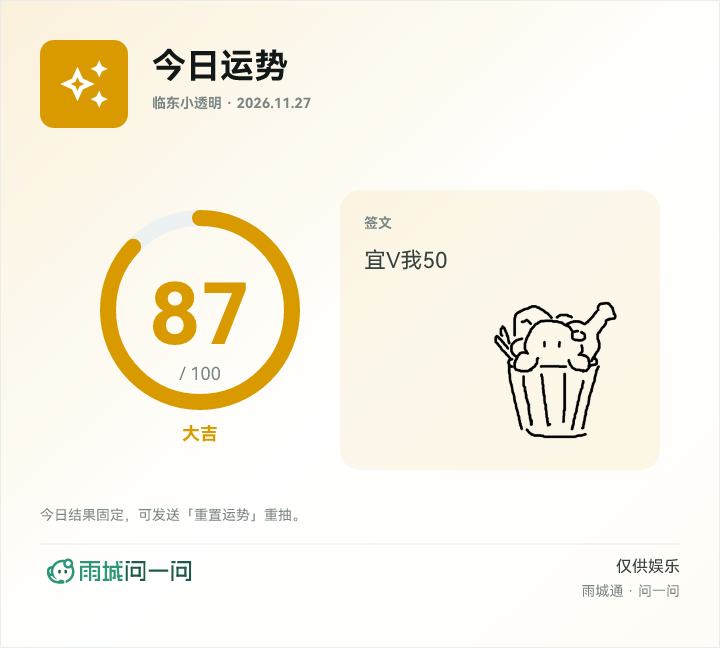
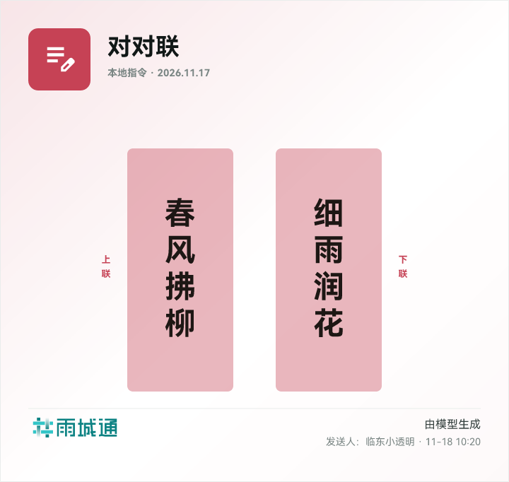

# QQ 机器人快捷指令

更新时间：2026-11-19

这些指令在机器人本地处理，不经过问一问的检索和主问答链路，也不需要网页端提供接口。
代码在 `integrations/qq-bot/src/commands.mjs`，数据在 `integrations/qq-bot/data/`。

群聊里同样要先 @ 机器人。指令可以加 `/`，也可以直接用自然触发词，例如 `计算 1+2`、`上海天气`、`历史上的今天`。

## 指令一览

| 指令        | 示例                                                    | 说明                                                               |
| ----------- | ------------------------------------------------------- | ------------------------------------------------------------------ |
| `/随机`     | `/随机`、`随机数 10`、`随机数 1-10`、`随机数 1 10`      | 默认 1-100；支持上下限、`5-10` 和 `5 到 10` 写法                   |
| `/骰子`     | `/骰子`、`/掷骰子`、`/2d6`、`2个6面骰`                  | 不写参数默认 1d6；6 面骰画点数，支持 `3d6+2`                       |
| `/算`       | `/算 (1+2)*3`、`计算 (1+2)*3`、`/算 sqrt(9)+2`          | 四则、乘方、括号、`sqrt/abs/round/floor/ceil`，支持全角数字和 `×÷` |
| `/电码`     | `/电码 临东`、`电码 临东`、`中文电码 临东`              | 中文电码，返回每个字的四位码                                       |
| `/gb2312`   | `/gb2312 临东`、`汉字编码 临东`、`GB2312 临东`          | 返回 GB2312 十六进制码；6 个字以内附带区位码                       |
| `/天气`     | `/天气`、`天气 上海`、`上海天气`、`天气怎么样`          | 不写城市时用 `QQ_BOT_WEATHER_CITY`                                 |
| `/ip`       | `/ip 8.8.8.8`、`查IP 8.8.8.8`                           | 必须带地址；不带地址会拒绝查询，避免泄露机器人出口 IP              |
| `/历史`     | `/历史`、`历史上的今天`、`/历史 3月5日`、`历史 3-5`     | 查询任意月日的历史事件，不写日期时取上海时区当天                   |
| `/对联`     | `/对联 春风拂柳`、`对对联 春风拂柳`                     | 调用模型只对下联，不输出横批，会产生一次额外的模型调用             |
| `/签到`     | `/签到`、`签到`、`打卡`                                 | 每个群每天一次，记录累计次数和连续天数                             |
| `/签到榜`   | `/签到榜`、`签到排行`                                   | 本群累计签到前 10 名                                               |
| `/发言统计` | `/发言统计`、`发言统计 7`                               | 今日或最近 N 天的消息条数、参与人数、活跃天数                      |
| `/发言榜`   | `/发言榜`、`发言榜 7`                                   | 今日或最近 N 天发言条数前 10 名                                    |
| `/运势`     | `/运势`、`今日运势`、`抽签`                             | 1-100 分 + 一条随机文案，当天固定                                  |
| `/人数`     | `/人数`、`在线人数`、`服务器状态`、`谁在线`、`在线玩家` | 读取站内服务器状态和在线玩家名单；未知时明确提示，不返回 0 人      |
| `/随机地点` | `/随机地点`、`手气不错`、`随便逛逛`                     | 从公开 POI 中随机抽一个，返回地图分享链接和 POI 卡片               |
| `/重置运势` | `/重置运势`、`重抽运势`                                 | 重抽当天运势                                                       |
| `/帮助`     | `/帮助`、`菜单`、`功能`                                 | 列出这些指令和问一问的用法                                         |
| `/关于`     | `关于机器人`、`/关于机器人`                             | 机器人简介和数据来源                                               |
| `/版本`     | `/版本`、`机器人版本`、`版本`                           | 机器人版本、卡片渲染方式和网页当前 build                           |
| `/绑定`     | `/绑定`、`/绑定 绑定码`                                 | 私聊生成一次性链接，或消费绑定码；群里 @机器人 生成群专属链接      |
| `/确认`     | `/确认 482913`                                          | 群聊绑定第二步，确认码必须是 6 位数字                              |
| `/我的绑定` | `/我的绑定`、`查看绑定`                                 | 查询当前 QQ 在当前会话/群绑定的临东通账号                          |
| `/解绑`     | `/解绑`、`/解绑 确认`                                   | 二次确认后解除当前会话/群的 QQ 绑定                                |
| `/新对话`   | `/新对话`、`/new`、`新对话`                             | 清空当前对话上下文                                                 |
| `/模块`     | `/模块`、`/模块 关 天气`、`/模块 开 公交`               | 查看或调整本群功能开关；只有群主和群管理员可以修改                 |
| `/物料`     | `/物料`                                                 | 随机物料玩法说明：五个族、模板、编号和 30 天分享有效期             |
| `/盲盒`     | `/盲盒`、`/随机物料`                                    | 从 19 个系统模板里随机一张，出图并带二维码                         |
| `/路牌`     | `/路牌`                                                 | 道路路名方向牌                                                     |
| `/楼牌`     | `/楼牌`                                                 | 楼栋地名标志（默认 / 怀旧随机）                                    |
| `/站牌`     | `/站牌`                                                 | 公交站牌（6 种版式随机）                                           |
| `/地铁`     | `/地铁`                                                 | 地铁线路图 / 站名 / 方向 / 站台牌 / 导视牌随机                     |
| `/数据源`   | `/数据源`、`/数据源 示例`、`/数据源 服务器`             | 查看或切换本群物料线网来源；只有群主和群管理员可以切换             |

未知的 `/xxx` 会提示发送「菜单」，不会当成普通问题交给模型。自然语句只有明确命中上面的句式才会被接管，
像“计算器怎么用”“随机数是多少”“电码是什么”这类问法会继续交给问一问。

## 按群功能开关

每个群可以单独关闭指令和问一问的内容范围，配置保存在机器人目录的
`state/group-modules.json`（可用 `QQ_BOT_GROUP_CONFIG_PATH` 改），没有配置文件时按注册表默认值：
日常指令默认开，玩家进出播报和服务器消息默认关、需要按群开启；运维提醒不在群模块里，走私聊管理员。
完整设计见 [QQ_BOT_GROUP_MODULES.md](./QQ_BOT_GROUP_MODULES.md)。

### 权限

- 群主和群管理员可以改本群开关，身份取自事件里的 `author.member_role`；
- 普通成员只能查看 `/模块` 和帮助，不能修改；
- 平台没有下发 `member_role` 时按“身份未知”处理，拒绝修改；可用 `QQ_BOT_MODULE_ADMINS`
  配置 `群openid:成员openid` 白名单兜底；
- 运维可以在配置文件里给某个群加 `locked`，锁定的项群里只读；
- 每次修改写入 `state/module-audit.jsonl`，群号和 openid 都打码。

### 常用操作

| 用法                  | 说明                                     |
| --------------------- | ---------------------------------------- |
| `/模块`               | 列出本群所有模块和开关状态               |
| `/模块 关 天气`       | 关闭单个指令                             |
| `/模块 开 天气`       | 单独打开指令（所属模块仍关闭时会提示）   |
| `/模块 关 公交`       | 关闭问一问「公交与线路」范围             |
| `/模块 关 问一问`     | 一次关闭问一问五个可关范围               |
| `/模块 详情 实用工具` | 查看模块包含的指令、当前状态和最后修改人 |
| `/模块 恢复默认`      | 清除本群自定义开关                       |

### 关闭后的表现

- 指令被关闭：`「天气」在本群未开启。群主或管理员可以 @我 发送 /模块 开启。`
- 问一问范围被关闭：`本群未开启「公交与线路」问答。群主或管理员可以 @我 发送 /模块 开启。`
- 同一群同一功能 10 分钟内只提示一次；`QQ_BOT_MODULE_HINTS=0` 可以全部关闭提示。
- 帮助菜单会列出“本群未开启”的项；`/模块` 对所有人可见，避免成员误以为机器人坏了。

### 常驻和可关范围

- 常驻不可关：菜单/帮助、关于、版本、新对话、`/模块`，以及问一问的「使用说明」；
- 指令类可关：实用工具、群互动、查询指令、账号绑定、视频解析、物料盲盒；
- 事件类可关：进退群提示、玩家进出播报、服务器消息；可选模块默认关，需 `/模块 开`。
- 问一问可关：临东服资料、公交与线路、公告与运营、地图与地点、通用问答。

## 自然触发词

| 句式                             | 例子                                      | 解析规则                                           |
| -------------------------------- | ----------------------------------------- | -------------------------------------------------- |
| 计算【列式】                     | `计算 (1+2)*3`、`计算1+2`                 | 后面的内容必须含数字或运算符，否则不接管           |
| 随机数【最小值】-【最大值】      | `随机数 1-10`、`随机数 1 到 10`           | 不写范围默认 1-100                                 |
| 【地名】天气                     | `上海天气`、`上海今天天气`                | 会去掉“今天/明天/现在”等时间词                     |
| 天气【地名】                     | `天气 上海`、`天气上海`                   | 不写地名用默认城市；“天气怎么样”也走默认城市       |
| 对对联【上联】                   | `对对联 春风拂柳`                         | 带“怎么/是什么”等问法时交回问一问                  |
| 查IP【IP】                       | `查IP 8.8.8.8`                            | 不写 IP 时查询服务器自己的地址                     |
| 历史上的今天【日期】             | `历史上的今天`、`历史 3月5日`、`历史 3-5` | 日期可写 `3月5日`、`3-5`、`2024-03-05`；不写取当天 |
| 汉字编码【文本】                 | `汉字编码 临东`、`GB2312 临东`            | 带“是什么”等问法时交回问一问                       |
| 电码【文本】                     | `电码 临东`、`中文电码 临东`              | 带“是什么”等问法时交回问一问                       |
| 签到 / 打卡                      | `签到`、`打卡`                            | 每个群每天一次                                     |
| 签到榜                           | `签到榜`、`签到排行`                      | 本群累计签到前 10                                  |
| 发言统计【天数】                 | `发言统计`、`发言统计 7 天`               | 天数可省略，默认今天                               |
| 发言榜【天数】                   | `发言榜`、`发言榜 7`                      | 天数可省略，默认今天                               |
| 今日运势 / 重置运势              | `今日运势`、`重置运势`                    | 当天固定，重置后重抽                               |
| 随机地点                         | `随机地点`、`手气不错`、`随便逛逛`        | 从公开 POI 随机抽一个                              |
| 物料盲盒                         | `物料盲盒`、`随机物料`                    | 从 19 个系统模板里随机一张物料                     |
| 物料 / 路牌 / 楼牌 / 站牌 / 地铁 | `物料`、`路牌`、`站牌`、`地铁`            | 完全匹配才接管；带“怎么/是什么”等问法交回问一问    |
| 随机路牌 / 来张站牌 / 抽个楼牌   | `随机路牌`、`来张站牌`、`抽个楼牌`        | 必须带“随机/来张/抽个”等前缀；带问法交回问一问     |
| 数据源【示例/服务器】            | `数据源`、`数据源 示例`、`数据源 服务器`  | 查看或切换本群物料线网；修改仅群主/管理员          |
| 模块【开关/详情】                | `模块`、`模块 关 天气`                    | 等同 `/模块`；修改仅群主/管理员                    |
| 地铁盲盒                         | `地铁盲盒`                                | 等价于 `/地铁`，随机一张地铁物料                   |
| 菜单 / 功能 / 关于机器人         | `菜单`、`功能有什么`、`关于机器人`        | 菜单返回帮助，关于返回简介                         |

## QQ 指令入口适配

QQ 开放平台的机器人指令入口只接受**以 `/` 开头、中间没有空格**的命令名，用户点击后会直接把命令发出来，
不能等待补参数。但机器人同时兼容不带斜线的裸词（见上面的自然触发词），菜单或用户手打纯文本也能命中。
入口里只放“点了就能出结果”的命令：

| 入口命令    | 默认行为                                 |
| ----------- | ---------------------------------------- |
| `/随机`     | 1-100 随机数                             |
| `/掷骰子`   | 默认 1d6，卡面显示骰子点数               |
| `/天气`     | 查询 `QQ_BOT_WEATHER_CITY` 的天气        |
| `/历史`     | 历史上的今天                             |
| `/随机地点` | 随机公开 POI + 分享卡片                  |
| `/人数`     | 服务器在线人数与玩家名单；未知时明确提示 |
| `/签到`     | 本群今日签到                             |
| `/签到榜`   | 本群累计签到榜                           |
| `/发言统计` | 今天本群发言统计                         |
| `/发言榜`   | 今天本群发言榜                           |
| `/运势`     | 今日运势                                 |
| `/重置运势` | 重抽今日运势                             |
| `/帮助`     | 指令说明                                 |
| `/关于`     | 机器人简介                               |
| `/版本`     | 查看机器人版本和网页 build               |
| `/绑定`     | 私聊生成绑定链接；群里生成群绑定链接     |
| `/我的绑定` | 查询当前会话/群的绑定                    |
| `/解绑`     | 解除绑定（需 `/解绑 确认`）              |
| `/新对话`   | 清空当前对话上下文                       |
| `/物料`     | 查看随机物料玩法                         |
| `/盲盒`     | 全模板随机一张物料                       |
| `/路牌`     | 随机道路路牌                             |
| `/楼牌`     | 随机楼牌                                 |
| `/站牌`     | 随机公交站牌                             |
| `/地铁`     | 随机地铁物料                             |
| `/数据源`   | 查看本群物料数据源                       |

以下命令需要参数，不要挂到指令入口，否则点击后只会得到用法提示：`/计算`、`/查IP`、`/电码`、
`/gb2312`、`/对联`、`/确认`。其中 `/查IP` 不带地址时现在会直接拒绝，不再查询机器人所在服务器的出口 IP；
`/确认` 需要带上网页显示的 6 位确认码。

群聊 10 个、私聊输入框 10 个和私聊菜单 10 个入口怎么排，见 [QQ_BOT_MENU.md](./QQ_BOT_MENU.md)。

## 各功能的实现与外部依赖

### 随机数与骰子

- 使用 `node:crypto` 的 `randomInt`，不使用 `Math.random`。
- 骰子支持 `/掷骰子`、`/掷骰子 2d6`、`/掷骰子 2个6面骰`、`/掷骰子 3d6+2` 和 `/2d6`。
- 不写参数时默认 1d6；6 面骰画点数，常见面数按桌面骰子轮廓显示：D4 三角、D8 菱形、D10 风筝形、D12 五边形、D20 六边形，所有多边形带圆角，其他面数显示数字。
- 骰子数量 1-20、面数 2-1000，避免一次刷出过长的消息。
- 不依赖网络。

### 算式

- 自己实现的递归下降解析器，不调用 `eval` / `Function`。
- 支持 `+ - * / % ^`、括号、一元正负号、`pi` / `e` 和几个常用函数。
- 全角数字、`（ ）`、`×`、`÷`、`−` 会先归一化。
- 除零、括号不闭合、未知函数都会返回可读错误。

### 中文电码

- 数据来自站内电报纸使用的 `apps/web/lib/telegraph-codebook.ts`，生成到 `data/ccc.json`。
- 只收录单字映射；标点也有电码的按表返回。
- 一次最多 40 个字。

### GB2312

- 数据在 `data/gb2312.json`，按 CP936 编码后筛选 GB2312 区间（高位 `A1-F7`、低位 `A1-FE`），并验证能往返解码。
- 输出十六进制码；6 个字以内附带区位码，例如 `临 C1D9（33-57）`。
- ASCII 字符单独返回两位十六进制。
- 不在 GB2312 的字符会单独列出来。

这两个数据文件是静态表，更新时需要和 `src/`、`assets/` 一起复制到服务器。

### 天气

- 主题色从「天气现象 × 昼夜阶段」的天空色矩阵取色（`weatherSkyColors` / `weatherSkyColorAtTime`），按当前时刻在四列之间连续插值，再按气温做保持亮度的色温 / 色调偏移；用于卡片左上角渐变、标题图标块、当前天气面板底纹和天气图标：
  - 行是现象：晴、云、阴、雨、雪 / 冰 / 冻、雾 / 霾 / 沙 / 尘、雷、其它；列是昼夜阶段：清晨、白天、正午、傍晚、夜间。每个格子都是手选的天空色，不再把昼夜色混进现象色，避免混出水泥灰 / 脏橙色；清晨偏粉、白天保持饱和、正午前后提亮（保留饱和度再加明度）、傍晚偏橙金；
  - 天空色矩阵（所有色值都保证白图标对比度 ≥ 3:1；气温偏移保持相对亮度，所以天气卡片图标始终是白色、不会反色）：

    | 现象              | 清晨      | 白天      | 正午      | 傍晚      | 夜间      |
    | ----------------- | --------- | --------- | --------- | --------- | --------- |
    | 晴                | `#D7758D` | `#3B86C9` | `#6098CA` | `#C9761B` | `#22304A` |
    | 云                | `#C46E93` | `#3B9ADA` | `#499AD1` | `#C4842A` | `#2B5478` |
    | 阴                | `#AF888E` | `#8F9499` | `#8F9499` | `#B28B52` | `#333A44` |
    | 雨                | `#B582A2` | `#4C6A8A` | `#7C95B1` | `#AD8A4E` | `#29384C` |
    | 雪 / 冰 / 冻      | `#B780B7` | `#6F93A8` | `#7997A9` | `#BB8835` | `#35485E` |
    | 雾 / 霾 / 沙 / 尘 | `#B18981` | `#7C7B6E` | `#949489` | `#B7894D` | `#3B3A38` |
    | 雷                | `#B182BF` | `#5D5296` | `#958DBC` | `#C17C1D` | `#2D2A4A` |
    | 其它 / 兜底       | `#CF7D7D` | `#2584E8` | `#4F96E1` | `#C68325` | `#243349` |

  - 动态取色：卡片带查询时刻（`sun.minutes`）时，用日出 / 日落做锚点插值——日出前 1 小时到日出后 30 分钟由夜间过渡到清晨色，日出后 30 分钟到 2 小时过渡到白天色，正午（日出日落中点）提亮到正午色，随后在日落前 2 小时回到白天色；日落前 2 小时到日落后 30 分钟过渡到傍晚色，日落后 30 分钟到 2 小时回到夜间色；颜色按色相沿色环过渡：白天 → 傍晚走蓝 → 紫 → 红 → 橙，傍晚 → 夜间走橙 → 红 → 紫 → 蓝（两个方向都不经过黄绿，跨度大时中段降饱和），并在插值后压住白图标对比度；拿不到精确时刻时退回离散阶段色。
  - 气温偏移：以 17℃ 为中性、±20℃ 到最大幅度；冷端减红加蓝、热端加红减蓝（类似白平衡），偏移后把明度校准回原来的相对亮度，只变冷暖不变明暗，白图标对比度才稳定；深色天空（夜间）按明度收小偏移；
  - 夜间图标：当前时刻是夜间时，带太阳的天气图标换成月亮版——晴 → 月亮（`clear_night`），多云 / 其它 → 月 + 云（`partly_cloudy_night`），卡片左上角图标也换成月 + 云；预报行仍用白天图标；
  - 主题色只看当前天气，不再把未来几天的预报现象混进来；预报行小图标用对应现象「白天」列的天空色；
  - 预警条颜色按等级单独取蓝 `#2F7FD1` / 黄 `#C99512` / 橙 `#E07A26` / 红 `#D64545`，不参与主题色偏移；
  - 色卡：
- 卡片会显示当地日出 / 日落，并读取国家气象中心公开预警列表；有预警时在“现在”和“天气预报”之间增加预警条（不限条数，按蓝 / 黄 / 橙 / 红分级着色，并按大风 / 雨涝 / 雷电 / 冰雪 / 高温 / 雾霾 / 火险等种类显示不同图标）。只保留和当前地点相关的预警：区县重名时要求同时命中省，且标题里区名前面的市名就是当前城市（沈阳铁西的预警不会串到鞍山铁西的卡片），省级预警在没有出现其他城市时保留。预警条本身不使用底色、边框或左侧色条，只保留彩色图标和两行文字，并给整组列表增加左右和上下内边距。预警接口失败时静默降级，不影响天气卡片本身。
- 卡片标题只写查询地点本身，不写省名；副标题在日期前补「省+市」（如 `辽宁沈阳`、`北京`），用于区分省内重名区县。
- 配置了 `QQ_BOT_AMAP_KEY` 时优先走高德天气：
  - 先用 `restapi.amap.com/v3/geocode/geo` 把城市名解析成 adcode；
  - 标题使用解析后的市 / 区（不写省）：`浦东天气` 显示 `浦东天气`，`沈阳天气` 显示 `沈阳天气`；副标题显示 `上海` / `辽宁沈阳` 这样的省+市，用于区分重名区县；
  - 副标题和文字回复标题的省 / 市 / 区以 geocode 返回的行政区划为准：高德 `weatherInfo` 的 `city` 字段是“查询到的区域名”，按区县 adcode 查询时返回区名本身（如 `city=110101 → 东城区`），不能当市名用。所以 `沈阳铁西` / `鞍山铁西` 的副标题分别是 `辽宁沈阳` / `辽宁鞍山`，文字回复是 `辽宁省沈阳市铁西区天气` / `辽宁省鞍山市铁西区天气`；
  - 再并行请求 `weatherInfo` 的 `base`（实时）和 `all`（预报）。
- 不填高德 Key 时回退到 wttr.in（免费、无需 Key），天气描述由本地代码表翻译；
  wttr 的 `nearest_area` 会显示实际观测点，例如 `上海（浦东，中国）天气`，
  不会只写“上海天气”。
- 需要配置真实城市名：

  ```dotenv
  QQ_BOT_WEATHER_CITY=上海
  QQ_BOT_AMAP_KEY=你的高德 Web 服务 Key
  ```

  “临东市”这类虚构地名查不到，会提示改成真实城市名。

- 高德结果缓存 60 分钟，adcode 解析结果常驻内存；按每月 5000 次额度，正常频率足够用。
- wttr.in 结果缓存 10 分钟。
- 输出当前温度、湿度、风和最多 5 天的高低温、天气（高德和 wttr 有多少天就展示多少天，最多 5 天）。
- 服务器需要能出站访问 `restapi.amap.com` 或 `wttr.in`。

### IP 属地

- 优先 `ipwho.is`（`lang=zh-CN`，中文国家/省/市），失败回退 `ipapi.co`（英文）。
- 只接受 IPv4 / IPv6；不解析域名，避免 CDN 和 anycast 导致结果误导。
- 不写地址时查询机器人所在服务器的出口 IP。
- 结果缓存 10 分钟。
- 输出示例：`114.114.114.114：中国 江苏省 南京 · China Telecom AS137702`。

### 历史上的今天

- 数据源：百度百科的按月事件 JSON（`baike.baidu.com/cms/home/eventsOnHistory/<月>.json`），中文，无需 Key。
- 按 `Asia/Shanghai` 取月日；支持查询任意月日：`3月5日`、`3-5`、`2024-03-05`，不写日期时取当天；优先选 `type=event` 的事件，再补出生/逝世，最多 6 条。
- 标题里的 HTML 标签会被清掉。
- 同一月日缓存 6 小时。
- 如果百度接口不可用或当天没有数据，返回可读错误，不影响其他功能。

### 对对联

- 走 `src/model-api.mjs` 直连模型服务商，和二次精炼共用同一份 Key。
- 同一个 `/对联` 接口同时兼顾普通对联和无情对：提示词优先按无情对处理，要求字面工整、词性相对、语义尽量不相干；如果上联明显是普通对联，也允许兼顾意境。
- **只输出下联，不再生成横批**，适合偶尔玩，不建议刷屏。
- 会产生一次额外的模型调用。

### 签到与签到榜

- 数据保存在机器人本地 JSON（默认 `state/qq-bot-state.json`，可用 `QQ_BOT_STATE_PATH` 改）。
- 按“群 + 用户”记录：累计签到次数、连续天数、最后签到日期；日期按 `Asia/Shanghai`。
- 每天只能签到一次；断签后连续天数从 1 重新开始。
- 签到榜按累计次数排序，最多显示 10 人。

### 发言统计与发言榜

- 机器人收到的 `GROUP_AT_MESSAGE_CREATE` 一定会计数；如果开放平台开通了“接收所有消息”，
  `GROUP_MESSAGE_CREATE` 也会计数（只统计、不回答）。
- 同一条消息重复推送按消息 ID 去重，不会重复计数。
- 统计口径：
  - 次数：消息总条数；
  - 人数：去重后的发言用户数；
  - 天数：统计区间内有发言的天数。
- 默认看今天，`发言统计 7` / `发言榜 7` 看最近 7 天；最多 90 天。
- 消息按天保存，超过 90 天自动清理。
- 没有开通“接收所有消息”时，统计只覆盖 @机器人 的消息，回复里会明确标注这个范围。

### 今日运势

- 分数使用 `crypto.randomInt` 生成 1-100，文案从 `data/fortune-texts.txt` 随机选一条。
- 文案一行一条，可直接编辑；修改后重启机器人。状态里只保存文案索引，改短文件时会自动回退到第一条。
- 按“用户 + 日期”保存；同一天重复查询结果不变。
- `重置运势` 会重抽并覆盖当天结果，方便不满意时换一个。
- 结果只存在机器人本地，不同步到网页账号；仅供娱乐。

### QQ 绑定

绑定分单聊和群聊两套身份，两边的 openid 命名空间不互通：单聊只用 `author.user_openid`，
群聊只用事件里的 `group_openid` + `author.member_openid`。

#### 单聊（保持原样）

- `/绑定`：调用临东通 `POST /api/internal/qq-link/token`（`scope: "c2c"`），回复一次性链接。
- `/绑定 绑定码`：兜底方式，调用 `consume` 消费临东通账号设置里生成的绑定码。
- `/我的绑定`：调用 `resolve?scope=c2c`。
- `/解绑 确认`：调用 `unlink`（`scope: "c2c"`）。
- 私聊绑定后，问一问自动带入账号上下文；群聊不带。

#### 群聊（新增）

- 群里 @机器人 `/绑定`：
  1. 机器人只从当前事件读取 `group_openid` 和 `author.member_openid`；
  2. 调 `POST /api/internal/qq-link/token`，请求体 `openId=member_openid`、`scope: "group"`、
     `groupOpenId=group_openid`；
  3. 用 URL 解析器从返回的 `url` 里取 `token` 参数，写入内存缓存；
  4. 回复服务端返回的一次性链接，不单独回复 token。
- 用户打开链接登录临东通，网页只显示 6 位确认码。
- 同一群、同一成员 @机器人 `/确认 482913`：
  1. 校验确认码必须是 6 位数字；
  2. 用当前事件的 `group_openid` + `member_openid` 从缓存取 token；
  3. 调 `POST /api/internal/qq-link/confirm-group`，`token` 用缓存值，
     `openId`/`groupOpenId` 强制使用当前事件身份，`code` 用命令参数；
  4. 成功删除缓存，回复“群绑定成功：本群已绑定到临东通账号：@username”。
- 群内 `/我的绑定`：调 `resolve?openId=<member_openid>&scope=group&groupOpenId=<group_openid>`。
- 群内 `/解绑 确认`：调 `unlink`（`scope: "group"`），只解除当前群身份，不影响单聊和其他群。
- **身份规则**：不读取消息里手写的任何 openid；群主/管理员没有特权；`/确认` 永远使用当前
  事件发送者的 `member_openid`，不会把别人的 token 或 openid 传进去。
- **缓存**：key 为 `group_openid:member_openid`，TTL 取 5 分钟与服务端 `expiresAt` 中更早者，
  容量默认 10000，超限按最早过期时间淘汰；只存内存，不落库、不写日志，进程重启丢失可接受。
- 群 token 缓存和单聊路径完全分开，单聊不会读取群缓存。

群确认错误处理：

| 服务端错误码                                     | 机器人处理                                         |
| ------------------------------------------------ | -------------------------------------------------- |
| `token_used` / `token_expired` / `token_invalid` | 删除缓存，提示重新 `/绑定`                         |
| `token_not_claimed`                              | 保留缓存，提示先打开网页登录并查看确认码           |
| `confirm_code_invalid`                           | 保留缓存，提示确认码不对，回网页看最新确认码       |
| `openid_mismatch` / `group_mismatch`             | 保留缓存，提示不是发起绑定的成员，不能代确认       |
| `token_claimed`                                  | 删除缓存，提示链接已被其他临东通账号打开，重新绑定 |
| `openid_already_linked` / `link_conflict`        | 保留缓存，提示已绑定其他账号或存在冲突             |
| `account_inactive`                               | 保留缓存，提示打开链接的临东通账号不可用           |
| `rate_limited`                                   | 保留缓存，提示稍后再试                             |
| 网络错误 / 5xx                                   | 保留缓存，提示稍后重试，不回显底层响应             |
| 并发重复 `/确认` 后到者收到 `token_used`         | 按“已处理”友好回复，可发 `/我的绑定` 查看结果      |

安全约定：token、链接、确认码、完整 openid/group_openid 不写日志、不落库；错误响应不回显
token、确认码或请求体。调试日志最多记录错误码。

需要配置（复用单聊的同一套密钥，不新增 secret）：

```dotenv
LDPASS_API_BASE_URL=https://ldpass.example.com
QQ_BOT_LINK_SECRET=与临东通一致的随机串
QQ_BOT_CONTEXT_SECRET=与网页 YCT_QQ_CONTEXT_SECRET 一致
QQ_GROUP_LINK_ENABLED=1
QQ_BOT_GROUP_LINK_TTL_MS=300000
QQ_BOT_GROUP_LINK_CACHE_MAX=10000
QQ_BOT_LINK_TIMEOUT_MS=20000
```

平台侧：群绑定使用已有的 `GROUP_AT_MESSAGE_CREATE`（群聊 @ 机器人）事件，不需要新增 intent；
机器人需要在群里并具备群聊消息事件权限。回复里含一次性链接，若平台提示 `40054010`，
需要在 QQ 开放平台申请 URL/链接权限。

### 随机地点

- 调用站内已有的 `/api/map/random-poi`，只从公开、已发布且有几何的 POI 中抽取。
- 文字回复地点名、类型、地址和分享链接；图片卡片显示地点名、描述、地址、营业时间和坐标。
- 卡片左上角优先显示该 POI 自己的地图图标（经站内代理预取），主题色优先使用 POI 分类的语义色；没有分类色或图标时回退 Material Symbol / 卡片主色。
- 分享链接使用 `YCT_PUBLIC_BASE_URL` 拼成完整地址；没配置时退回 `YCT_BASE_URL`。
- 没有封面时使用内置地图渐变占位图；二维码仍会生成。
- 接口返回 404/503 时只发文字提示，不发送空白卡片。

### B 站视频

- 消息里出现 `bilibili.com/video/...` 或 `b23.tv/...` 时，先读视频信息，再发文字和封面海报。
- 文字包含标题、UP 主和标准视频链接；海报使用视频封面，走 QQ 富媒体上传。
- 通过 `QQ_BOT_BILIBILI=0` 可以关闭，关闭后链接会交回问一问处理。
- B 站接口失败时不会拦截消息，仍按普通问题回答。

### 群进退群提示

- 文案在 `data/group-notices.json` 按群配置，支持 `welcome`、`kick`、`leave`。
- 支持 `{name}`、`{id}`，也兼容旧文案里的 `【发送者名片】`、`【发送者QQ】`、`【艾特】` 和 `【换行】`。
- 官方 QQ 机器人不保证下发普通成员进退群事件；未下发时需要 OneBot/群管事件桥接。

### 回答配图（可选）

- 问一问的运营内容引用可能带 `imageUrl`（运营封面）。
- 配置 `YCT_PUBLIC_BASE_URL` 为站点的 HTTPS 公网地址、并保持 `QQ_BOT_IMAGES=1` 时，
  机器人会先上传封面，再发送文字回答，最后补一张图片消息。
- 群聊里的图片走**主动消息**（不带 `msg_id` / `msg_seq`），不会让文字回答再 @ 发起者一次；
  单聊仍走普通被动图片。
- 不再使用 Markdown 图文消息：手机 QQ 只显示 `[封面]` 文本，兼容性不可靠。
- 图片必须是 HTTPS，且域名在 `YCT_PUBLIC_BASE_URL` 或 `QQ_BOT_IMAGE_HOSTS` 内。
- 上传失败只发纯文字；主动图片发送失败只写日志，不影响已发送的文字。

### 指令结果卡片

除 **签到、帮助、关于机器人、新对话** 外，其余本地指令都会附一张 720px 宽的 PNG 卡片，包括：

- 随机数、骰子、算式、中文电码、GB2312；
- 天气、IP 属地、历史上的今天、对对联、随机地点；
- 签到榜、发言统计、发言榜、今日运势、重置运势。

群聊里卡片先作为**主动图片**发送，再发被动文字回复；图片不带 `msg_id`，所以整轮只 @ 发起者一次。
单聊则是文字后附卡片图片。

卡片版式对齐地图分享卡片 `.map-share-preview`：

- 白色底、主题色淡面性色块，不再给灰色面板加细描边；
- 顶部主题色图标块直接使用 **Material Symbols** 图标（中文电码用自绘莫尔斯符号），
  标题/眉题显示关键词（如“上海天气”“1-10随机数”“(1+2)*3”）；
- 底部直接使用站内 `yct-logo-wordmark.svg` 字标，右侧两行显示来源、发送人和发送时间；
- 颜色和正文字体沿用站点设计 token / HarmonyOS Sans SC。

各类结果分别处理：

- 随机数、骰子、算式、IP 属地：大字号结果面板，去掉左侧竖线；
- 天气：仿天气 App，大号当前温度 + 天气图标 + 最多 5 天预报；
- 中文电码：直接使用提供的绿色电报纸行 SVG，每个汉字格下面直接放该字的四位码；
- GB2312：直接使用提供的红色答题卡行 SVG，**一行 3 个字**，每个字从上到下依次是
  汉字、四位十进制区位码（每位一个小格）、0-9 涂卡气泡（0 在最上、9 在最下）；选中的数字中心盖黑色短横线，最多展示前 6 个字；
- 今日运势：黄色分数圆环 + 吉凶 + 签文，签文区右下角按文案配一张手绘表情；
  表情放在 `apps/web/public/fortune-stickers/`，文案对照表见 `apps/web/lib/qq-bot-fortune-stickers.ts`；
- 对对联：红纸竖排上联/下联，字更大、底色更浓；上联/下联标签竖排放在红纸两侧；只对下联，不生成横批；
- 发言统计：三个大数字指标 + 统计范围；
- 签到榜/发言榜：排名列表；
- 只有历史保留少量 chip，其余卡片不再铺 chip。

实现细节：

- 渲染地址是网页端的 `/api/qq-bot/card`，机器人把卡片数据 base64url 后放进 `d` 参数；
- 需要 `YCT_PUBLIC_BASE_URL`、`QQ_BOT_CARDS=1`，且网页端已部署该路由；
- 图片会占用一次被动回复序号；渲染或上传失败只写日志，不影响文字回复。

示例：











更多：[签到榜](assets/qq-bot-cards/signin-board.png)、[发言统计](assets/qq-bot-cards/stats.png)、
[发言榜](assets/qq-bot-cards/board.png)、[算式](assets/qq-bot-cards/calc.png)、
[IP 属地](assets/qq-bot-cards/ip.png)。

## 随机物料（物料盲盒）

机器人在本地只负责收指令、拼卡片和发图；牌面由网页端
`POST /api/qq-bot/materials/render` 渲染（HMAC 验签、全局限流 60 次/分钟、并发 2），返回 PNG、
card 元数据和 30 天有效的分享短链。卡片右下角带二维码，扫码进工作台继续编辑。

- 指令：`/物料`（说明）、`/盲盒`、`/路牌`、`/楼牌`、`/站牌`、`/地铁`、`/数据源`；
- 开关：注册为 `/模块` 的「物料盲盒」，关闭后连 `/数据源` 一起停用；过渡期可用 `QQ_BOT_MATERIALS=0` 停用；
- 数据源：按群保存，默认「服务器线网」；群主或管理员可用 `/数据源 示例` 切到「沈阳示例线网」，
  切回用 `/数据源 服务器`。示例线网只开放地铁物料，`/路牌` `/楼牌` `/站牌` 会直接提示不支持、不出图；
- 许可：示例线网物料在卡片、文字回复里固定标注「沈阳示例线网 · CC BY-NC-SA 4.0 · railmapgen.org」，
  缺少许可信息时不出图；
- 错误：签名/配置问题提示「物料功能还没有配置完成」；限流提示等待秒数；数据源不可用提示稍后再试，
  示例线网失败时不会静默切回服务器线网；
- 配置：`QQ_BOT_MATERIAL_SECRET` 必须与网页端 `YCT_QQ_MATERIAL_SECRET` 一致，
  `QQ_BOT_MATERIAL_TIMEOUT_MS` 默认 20000（冷启动出图可能超过 8 秒），按群数据源保存在
  `state/material-sources.json`（可用 `QQ_BOT_MATERIAL_SOURCE_PATH` 改）。

## 与问一问的关系

- 指令在 `bot.mjs` 里先于问一问处理：命中 `/` 指令就直接回复，不进入检索、工具调用和主问答。
- 不读账号、不读页面上下文，也不会把指令写进对话历史。
- 指令回复同样受 QQ 被动回复规则限制：群聊 5 分钟/5 次、单聊 60 分钟/4 次。
- 目前指令没有单独限流；如果担心 `/对联` 被刷，可以在反向代理或 `bot.mjs` 里按用户加限流。

## 部署注意

- 新增了 `data/` 和 `state/` 目录，更新时把 `src/`、`data/` 和 `.ps1` 一起复制到服务器，保留 `.env` 和 `state/`。
- 不需要安装依赖，仍然只需要 Node.js 22+（当前部署 Node 24）。
- 天气和 IP 需要服务器出站访问对应 API；历史数据需要访问百度百科。若服务器网络受限，对应指令会返回错误，不影响问一问。
- 配图需要 `YCT_PUBLIC_BASE_URL` 是 QQ 能访问的 HTTPS 公网地址；`127.0.0.1` 或内网地址会被跳过。
