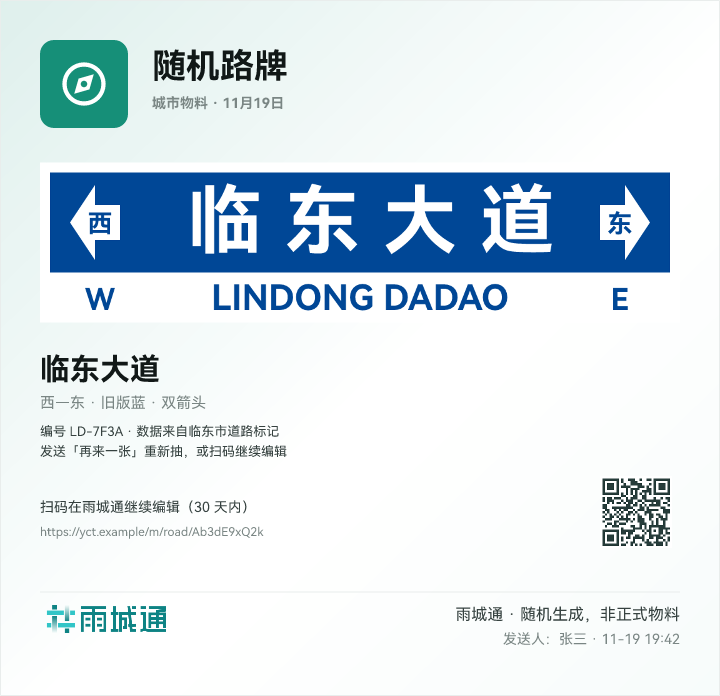
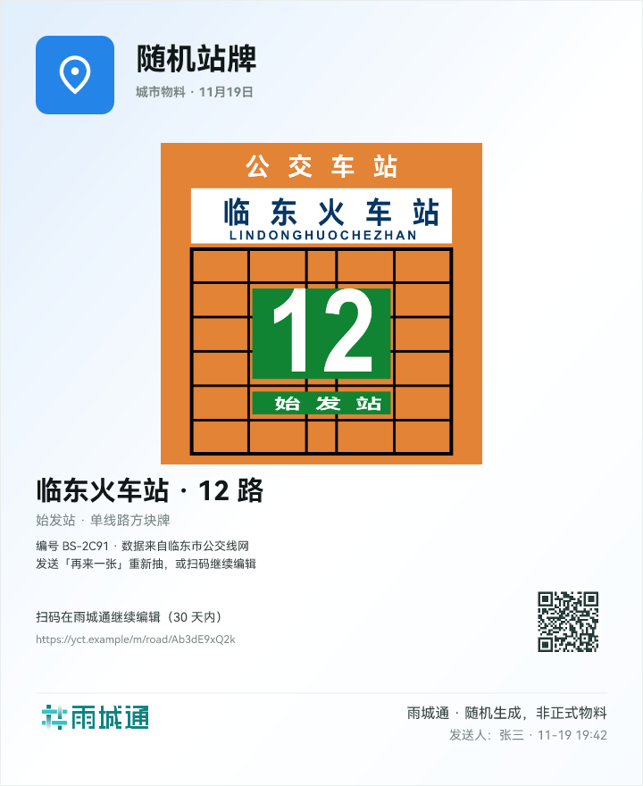

# QQ 机器人随机物料（导视 / 路牌 / 楼牌 / 站牌）方案

更新时间：2026-11-19
状态：P1 已实现（M1–M4），代码、测试与构建已通过，待部署与真机验收。文中工作量为单人估算。
已确认：扫二维码直接进编辑器；分享记录同时进物料后台；P1 覆盖全部系统模板；按群可切换服务器 / 示例线网，切换仅限群主与群管理员；工作台也支持发起分享，未审核的自定义内容分享图必须带水印；文本全部来自数据源，不设虚构名称；不做牌面角标；模块默认对所有群开放；群共享 RMP 不排期。执行排期见第 9 节。

## 1. 背景

雨城通已经有完整的物料链路：模板注册、结构化字段、服务端 SVG → PNG 渲染、审核与审计，入口在网页工作台 `/services/road-materials` 与 `/services/transit-materials`。现有模板覆盖道路路名方向牌、楼栋地名标志（默认 / 怀旧）、公交换乘站牌（始发终到 / 线路概览 / 线路详情）、地铁线路图 / 站名 / 方向 / 站台站名标志等。

QQ 机器人已经具备本地指令分发、卡片渲染和图片上传能力，群里 @ 机器人就能出图。把物料渲染接到机器人上，用户不用打开网页、不用登录，就能得到一张牌面图片。

旧站“实验室”里本来就有路牌生成器、楼牌生成器之类的入口（见 `docs/GOALS.md`）。这次不是新造概念，而是把旧玩具搬进群聊，并接上真实线网与地点数据。

## 2. 先回答“有没有用”

**结论：有用，但它的用途不是“替代工作台”，而是“群内娱乐 + 快速预览 + 导流”。**

有价值的场景：

1. **群内互动**：抽盲盒式生成——从 19 个系统模板里随机，内容抽真实道路、公交站、地铁站或导视牌，配一张成品图。成本低（纯本地渲染，不调用模型），适合群聊里反复玩。
2. **建城取材**：玩家在游戏里要挂路牌、站牌、楼牌时，先用机器人看一眼牌面和配色，比开网页快得多；确定方向后再去网页精修、导出。
3. **扫码继续编辑**：卡片右下角放二维码，扫开直接落到这份物料的工作台，字段、画布、样式都还在；很多人不知道工作台能做什么，这是最顺的导流路径。
4. **示例线网玩法**：按群切到沈阳示例线网，能拿真实城市数据玩地铁物料，不依赖服务器线网；带 CC BY-NC-SA 4.0 标注。
5. **运营素材**：可以固定做“今日随机站牌”这类轻内容，图片自带品牌与编号，适合转发。

价值有限、不建议投入的地方：

1. **精确出图、高清、审核**：仍在网页，机器人不做，也不该做。
2. **长条模板的聊天观感**：6:1 的线路图 / 方向牌在群里字号会很小，只能当缩略图；看清细节要扫码进工作台，这是全覆盖的代价。

文本全部来自数据源（地图道路、POI 地址、已发布线网），系统本来就不生成名字，因此没有“虚构地名”这个选项，也不做相关开关。

**建议定位**：

- 主功能：`城市物料盲盒`——随机，覆盖全部系统模板，内容全部来自真实数据；
- 可选玩法：`示例线网`——按群切换，只开放地铁物料，带许可标注；
- 导流：每张图片带二维码，扫开直接进入这份物料的工作台；
- 输出一律标注“随机生成 / 非正式物料”，不进入物料审核与导出链路。

**判断是否值得继续做的指标**（MVP 上线 2–4 周）：

| 指标       | 口径                             | 期望                   |
| ---------- | -------------------------------- | ---------------------- |
| 使用量     | 每个活跃群每周的物料指令次数     | ≥ 5 次/群/周           |
| 重抽率     | 同一会话内 30 秒内再次生成的比例 | 20%–60%（太低=没兴趣） |
| 扫码率     | 二维码被扫开的次数 ÷ 生成数      | ≥ 15%                  |
| 扫码后转化 | 扫码后在工作台编辑或下载的比例   | ≥ 30%                  |
| 负反馈     | 因“仿冒/误导”产生的投诉或撤回    | 0                      |

达不到就停在 P1，不再投入群共享 RMP、每日一抽等扩展。

## 3. 产品设计

### 3.1 指令与触发

| 指令      | 行为                                                | 示例                      |
| --------- | --------------------------------------------------- | ------------------------- |
| `/物料`   | 说明菜单：五个族、覆盖的模板、编号规则、30 天有效期 | `/物料`                   |
| `/盲盒`   | 从全部 19 个系统模板里随机，抽到什么算什么          | `/盲盒`、`/随机物料`      |
| `/路牌`   | 道路路名方向牌                                      | `/路牌`                   |
| `/楼牌`   | 楼栋地名标志（默认 / 怀旧随机）                     | `/楼牌`                   |
| `/站牌`   | 公交站牌（6 个版式随机）                            | `/站牌`                   |
| `/地铁`   | 地铁线路图 / 站名 / 方向 / 站台牌 / 导视牌随机      | `/地铁`                   |
| `/数据源` | 查看或切换本群线网来源：`服务器` / `示例`           | `/数据源`、`/数据源 示例` |

规则：

- QQ 开放平台的指令入口只接受“点了就能出结果”的无参命令，所以 `/路牌`、`/楼牌`、`/站牌`、`/地铁`、`/盲盒` 都可以挂到入口；P1 不收参数，指定内容留到后续。
- 自然语句只接管明确句式：`随机路牌`、`来张站牌`、`抽个楼牌`、`地铁盲盒`、`物料盲盒`；带“怎么/是什么/申请/规范/多少钱”等问法时交回问一问，与现有“计算器怎么用”的处理一致。

### 3.2 生成规则：真实数据优先

随机不是“随便编”，而是“从服务器真实数据里抽”，并且**每个模板都走工作台已有的“套用数据”路径**，不另写一套字段映射。P1 覆盖全部 19 个系统模板（路牌 / 门牌 / 公交站牌 / 地铁 / 导视牌 5 个族）：

| 族         | 模板（版式 / 样式）             | 数据来源与套用方式                                                                | 牌面比例    |
| ---------- | ------------------------------- | --------------------------------------------------------------------------------- | ----------- |
| 路牌       | 道路路名方向牌                  | 地图道路坐标 → `resolveRoadCoordinateMaterialInput`（方位、箭头、底色由几何推导） | 4:1 裁切    |
| 门牌       | 楼栋地名标志（默认）            | 地点 / 已发布 POI 地址 → `resolveMaterialLocationInput`                           | 2:1         |
| 门牌       | 楼栋地名标志（怀旧）            | 同上，门牌数字走怀旧字形渲染器                                                    | 2:1         |
| 公交站牌   | 始发终到（方块 / 拟真）         | 公交站 + 线路 + 方向 + `terminalRole` → `resolveTransitStationMaterialInput`      | 1:1 / 1:1.4 |
| 公交站牌   | 线路概览（方块 / 拟真）         | 公交站 + 同向 2–6 条线路 → 同上                                                   | 1:1 / 1:1.4 |
| 公交站牌   | 线路详情（竖版） / 横版线路详情 | 公交站 + 单线路 → 同上                                                            | 1:1 / 2:1   |
| 地铁       | 横版线路图（新 / 旧）           | 线路 + 当前站 → `resolveTransitLineMaterialInput`                                 | 6:1         |
| 地铁       | 竖版线路图（新 / 旧）           | 同上                                                                              | 1:2.5       |
| 地铁       | 站名灯箱（新 / 旧）             | 线路 + 站 → 同上                                                                  | 4.5:1       |
| 地铁       | 方向及下一站（新 / 旧）         | 线路 + 站 + 行车方向 → 同上                                                       | 6:1         |
| 地铁       | 站台站名标志                    | 地铁站 + 方向 → `resolveTransitStationMaterialInput`                              | 1:1         |
| 地铁导视牌 | 自定义版式                      | 工作台模板库示例（`buildMetroWayfindingTemplateExamples`，站 + 线路）             | 4:1 / 竖版  |

「套用车站数据」就是工作台里同一套逻辑：选站 → 方向 → 线路 → 自动填字段；「模板库」在地铁导视牌这一族里直接复用现有示例布局，不再随机拼元素。生成时先构造候选池（模板 × 当前数据可满足的条件），再随机抽一个；没有满足条件的模板本轮不出现（例如没有始发线路就不出始发终到）。

具体数据来源：

- 道路名 / 路牌：`readMaterialLocations` 里的 uNmINeD 地图道路标记，按名称聚合成道路几何后随机取一条、再取几何上的一个点；
- 楼牌 / 门牌：地图地点与已发布 POI 的地址字段，`resolveAddressInformation` 解析门牌号，邮编沿用现有恒定的 `120000`；
- 公交站牌：已发布公交线路与站点（`listMaterialTransitStations`），线路编号、站序、首末班都来自线网数据；
- 地铁：已发布地铁线路（`listMaterialTransitLines`），站名、线路色、线路编号都来自线网数据；
- 地铁导视牌：用同一批真实站点/线路构造模板库示例；
- 拼音：`chinese-pinyin.ts` 的 `toUppercaseRoadPinyin` / `toUppercasePinyin`（pinyin-pro），不是另拼一套。

**不存在词库拼字**：系统只随机“抽哪一个真实对象、用哪个模板”，不会随机造字或拼名字。抽不到数据就返回“暂时抽不到”，不会用假名字兜底。

这样做的好处：

- **方向、箭头、底色自动正确**：路牌的方位模式、箭头样式、南北绿 / 东西蓝都由道路几何推导，不靠随机瞎猜；
- **同一对象不打架**：同一条路的底色与走向判定稳定，不会这次蓝下次绿；同一 seed 抽到的牌面完全一致；
- **不引入新数据源**：全部读取现有公开数据，地图或线网不可用时不生成。

公交站牌的版式仍按数据自动选：有始发 / 终到线路优先生成始发终到，同向多线路用线路概览，单线路用线路详情；候选池里每种版式都保留，按可用条件加权。

### 3.3 输出形态

**卡片**（720 px 宽，直接复用现有指令卡片的 `buildFrame`，与天气、随机数、随机地点等卡片同一套外观）：

- 头部：88 px 主题色圆角图标块（52 px Material Symbol）+ 34 px 类型标题（随机路牌 / 随机楼牌 / 随机站牌 / 随机地铁）+ 14 px 眉题（城市物料 · 日期）；
- 中部：牌面按固定媒体框缩放（宽 ≤ 640、高 ≤ 480，保持原比例）——2:1 和 1:1 的牌面能看清，6:1 的横版线路图会是一条窄图，1:2.5 的竖版线路图会是窄高图；下方再放对象名称、属性行、编号与数据来源；
- 右下角：72 px 二维码（沿用 POI 卡片的位置与尺寸）+ “扫码在雨城通继续编辑（30 天内）” + 短链原文；
- 页脚：左侧品牌字标，右侧来源与发送人 / 时间（`renderFooter`），来源固定为 `雨城通 · 随机生成，非正式物料`。

线路图 / 方向牌这类长条模板在手机群里字号会很小，这是“全覆盖”的代价：图片当缩略图看，真正要看清楚就扫码进工作台，那里是全尺寸画布。卡片整体高度控制在 1000 px 以内。

二维码只放在卡片上，不压进牌面；**不做牌面角标**，标识统一放在卡片页脚与文案里。

**文字回复**（一条）：

```text
随机路牌：临东大道（西—东）
编号 LD-7F3A｜发送「再来一张」重抽
扫码或打开 https://…/m/road/Ab3dE9xQ2k 继续编辑（30 天内有效，过期后仍会打开同一模板）
```

**发送顺序**：群聊先主动发卡片、再被动发文字（沿用现有本地指令流程，整轮只 @ 一次）；单聊文字在前、图片在后。

**图片规格**：

- 长边 ≤ 1280 px，PNG；牌面图约 30–80 KB，带二维码的成品卡片约 50–100 KB；
- 路牌裁掉模板画布上半部的空白（现有 2 m × 1 m 模板中牌面只占下半部）；
- 楼牌、站牌按比例缩放，四周补 8–16 px 留白。

### 3.4 扫码之后：直接落进工作台

- 二维码指向短链 `https://<站点>/m/<模板 slug>/<10 位 ID>`，例如 `/m/road/Ab3dE9xQ2k`；URL 里带模板 slug，所以即使分享记录不在了，也能落回正确的模板，而不是工作台首页。
  - 路牌 / 楼牌 → `/services/road-materials?material=<ID>`
  - 公交站牌（以及后续的站名 / 站台牌）→ `/services/transit-materials?material=<ID>`
- 工作台服务端读取分享记录，把模板、版本、字段、画布一次性载入，并**优先于本机草稿**：扫码后看到的必须是他刚抽到的那一块牌子，而不是上次没做完的草稿。
- 本机已有未保存草稿时，先用一次确认提示“载入这份物料会替换当前草稿”，确认后旧草稿仍留在服务端草稿列表，不静默覆盖。
- 载入后进入手动编辑状态，载入时的字段就是免审核基线：
  - 只调样式、箭头、画布 → 文本签名不变，登录并验证服务器账号后可直接下载无水印图；
  - 改字 → 变成自定义物料，下载前需要提交审核（沿用现有规则）。
- 顶部给一条来源提示：`来自 QQ 的随机物料 · LD-7F3A`，另给「新建空白模板」入口回到常规流程。
- 手机端直接进工作台的单抽屉布局；只想到手一张图、不想编辑的，也能在页面里预览和下载。
- 失效与降级：
  - 分享已过期 → 仍按 slug 打开同一个模板，提示“这份分享已过期，已为你打开原模板，可重新填写”，不白屏；
  - 分享记录不存在（例如更早的数据被清理）→ 仍按 slug 打开同族模板并提示；
  - 分享被管理员停用 → 提示“这份物料链接已被管理员停用”，不自动打开（停用是主动处置，优先于兜底）；
  - 模板已下架或版本不存在 → 回退到当前已发布的最新版本，并提示版式可能变化；
  - 未登录 → 可以编辑和预览，下载时按现有规则要求登录并验证服务器账号。

### 3.5 物料后台里的“分享记录”

分享链接不只是一次性跳转，还要能在后台看见、能处置：

- `/admin/materials` 在现有「模板 / 待审核物料 / 下载预览记录」之外增加第四段 **「分享记录」**。
- 列表字段：短链、人类编号（如 `LD-7F3A`）、类型、模板与版本、数据源（服务器 / 示例线网）、来源（机器人 / 工作台）、创建者（工作台分享才有）、创建时间、扫码次数、最近扫码时间、状态（有效 / 已过期 / 已停用）。
- 操作：复制链接、查看二维码（256 px，可另存或打印）、打开落地页、**停用**（二次确认）与恢复；已过期的记录仍可打开原模板或手动清理。停用后扫码会提示“链接已被管理员停用”，不进入编辑器。
- 检索：按编号、短链 ID、模板名搜索；按类型、状态、数据源、来源筛选；默认按创建时间倒序，分页加载。
- 机器人分享不展示 QQ 用户或群（生成时没存）；工作台分享展示创建者账号，方便追溯。
- 停用 / 恢复记录操作管理员与时间，写事件与日志，后台审计可查。
- （不进 P1，后续可选）从分享进入后新建的草稿 / 导出记录带上 `shareId`，后台可以从一条分享追到后续产物。

### 3.6 连续交互

- **「再来一张」**：不进 P1；P1 期间重发 `/盲盒` 或对应族指令即可。
- **「换颜色」「换方向」**：不进 P1，避免把机器人做成半个编辑器。
- **「去网页改」**：已由卡片二维码覆盖，落地即编辑器。
- **失败兜底**：数据源不可用 → “现在抽不到道路数据，晚点再试”；模板字段组合不满足 → 重抽 3 次仍失败则降级到同族最简版式；渲染失败 → “出图失败，换个族试试”；不返回空白图。

### 3.7 按群切换数据源

- `/数据源` 查看当前设置：`服务器线网` / `沈阳示例线网`。
- `/数据源 服务器`、`/数据源 示例` 切换；**按群保存**，重启保留，不影响其它群。
- **权限**：查看所有人可见，修改仅限**群主 / 群管理员**。直接复用 `/模块` 已有的 `member_role` 判断（`owner` / `admin`），未知角色时拒绝修改并提示“暂时无法确认你的群身份”；运维可用 `QQ_BOT_MODULE_ADMINS` 白名单兜底。和 `/模块` 一样，上线前先用真实日志确认线上事件确实下发 `member_role`；切换写模块审计日志（群哈希、操作者角色、前后值）。
- 切换回复要明确说清影响：`已把本群物料数据源切到「示例线网」：只开放地铁物料，路牌 / 楼牌 / 站牌暂不可用。` 反向切回时也提示恢复全部模板。
- 数据源只决定“生成时从哪套线网取数”，不改变已生成的分享：旧分享按存下的字段照常打开。
- **示例线网只开放地铁相关物料**：地铁线路图、站名、方向、站台牌、地铁导视牌；此时 `/路牌` `/楼牌` `/站牌` 直接提示“当前群使用示例线网，只支持地铁物料”，不报错也不出图，`/盲盒` 也只在 10 个地铁模板里抽。
- 示例线网用的是 Rail Map Painter 画廊的沈阳数据，许可为 **CC BY-NC-SA 4.0**：卡片、文字回复、分享落地页都必须写“沈阳示例线网 · CC BY-NC-SA 4.0 · railmapgen.org”，这不是可选项。
- 导入 RMP 项目 P1 不做。这里说的是“群共享 RMP 项目”：把用户上传的 RMP 线网发布给某个群，bot 用这份自定义线网当数据源；后续路径是网页登录用户导入项目 → “发布到群”生成群共享线网（快照 + 名称 / 许可 + 归属群）→ 群里 `/数据源 RMP` 选择；同样只开放地铁物料，且同样只允许群主 / 管理员切换。

### 3.8 工作台发起分享

和机器人分享共用同一套东西：`MaterialShareLink` 存储、`/m/<slug>/<id>` 路由、工作台载入、30 天有效期和过期 stub、后台「分享记录」。区别只在入口和文案：

- 入口：工作台工具栏加「分享」按钮（登录用户可见），弹窗显示短链 + 二维码，可复制链接、下载分享图。
- 分享图由网页端渲染：复用 `apps/web/lib/qq-bot-card.ts` 的 `renderQqBotCardPng` 和 P1 新增的 `signage` 卡片类型，不需要机器人参与；带水印的分支直接复用现有 `renderMaterialTemplateToPng({ watermark })` / `appendMaterialPreviewWatermark`，不新写水印。
- 现有水印的大字固定是“仅供预览”，分享图可以在两条 trace 行里写“未审核 · 用户分享”和分享编号；如果要把大字也改成“未审核”，给 `appendMaterialPreviewWatermark` 加一个 label 参数即可，都是小改动。
- 文案：机器人分享是“随机生成 · 非正式物料”，工作台分享是“用户分享 · 非正式物料”；编号用 `SH-` 前缀或内容摘要，不复用随机编号。
- 记录带 `origin: 'workbench'` 与 `createdBy`，后台可按来源 / 用户筛选；机器人分享为 `origin: 'bot'`，没有用户归属。
- 内容边界：允许分享当前编辑值（包括自定义改字），但**分享图的水印由服务端按内容状态决定，前端不能选**：

| 内容状态                                                  | 分享图         | 说明                                            |
| --------------------------------------------------------- | -------------- | ----------------------------------------------- |
| 服务器来源，且字段与服务端重新解析结果一致                | 允许无水印     | 需登录并验证服务器账号，服务端复核，不信前端    |
| 已审核草稿（`draftId` 对应 approved，字段与草稿一致）     | 允许无水印     | 与现有下载规则一致                              |
| 其它手动 / 自定义内容（包括改字未审核、文本未改但未审核） | **必须带水印** | 复用预览水印（“未审核 · 仅供预览”），不给无水印 |

- 分享记录存 `shareImageWatermark`，创建时服务端判定一次；判定只看服务端能复核的事实（来源解析结果、已审核草稿），不接受前端传的“未修改”标记。想拿无水印分享图，就提交审核通过后重新分享。
- 落地页对带水印的分享显示“未审核内容的预览分享，无水印下载需提交审核”。
- 后台可随时停用；带水印与否在列表里可见。
- 成本：创建 API 约 0.3 天、工具栏与弹窗 0.4 天、分享图接口（含水印分支）0.4 天、测试 0.4 天，合计 **+1–1.5 天**。

### 3.9 边界（明确不做）

- P1 只做随机盲盒；指定名称、换色 / 换向、「再来一张」都不进 P1。
- 不做无水印、高清导出；机器人图片分辨率固定上限，正式出图回网页。
- 不写物料导出审计，只写分析事件与结构化日志。
- 不参与管理员自定义模板和任意字段，只抽系统模板。
- 不承诺在群聊里看清 6:1 线路图的全部站名；看细节请扫码进工作台。
- 不生成虚构名称：文本全部来自数据源，系统不造字、不拼名字。
- 示例线网只开放地铁物料；群共享 RMP 项目不进 P1。
- 开关与公开范围复用正在做的「模块化管理」：物料盲盒注册成一个模块，**默认对所有群开放**，群主 / 管理员可用 `/模块` 单独关闭；模块化上线前用 `QQ_BOT_MATERIALS=0` 环境变量过渡，不另写白名单。

## 4. 技术方案

### 4.1 现有能力盘点

| 能力           | 位置                                                                                                            | 说明                                                                           |
| -------------- | --------------------------------------------------------------------------------------------------------------- | ------------------------------------------------------------------------------ |
| 系统模板注册   | `apps/web/lib/system-material-templates.ts`                                                                     | 5 个模板族（含地铁导视牌）、十余个已发布模板                                   |
| 字段校验与合成 | `apps/web/lib/material-svg.ts`                                                                                  | 变量替换、文本适配、字高规则、模板白名单校验                                   |
| PNG 渲染       | `apps/web/lib/material-renderer.ts`                                                                             | `@resvg/resvg-js` + 内置 HarmonyOS 字体 + 预览水印                             |
| 数据来源解析   | `material-location-source.ts`、`material-transit-source.ts`                                                     | 地点 / 道路 / 公交站 / 地铁线路 → 模板字段                                     |
| 机器人指令     | `integrations/qq-bot/src/commands.mjs`                                                                          | 别名表、自然语句、返回 `{ reply, card }`                                       |
| 卡片渲染       | `apps/web/lib/qq-bot-card.ts` → `src/card-renderer.mjs`                                                         | 卡片版式在机器人侧渲染（由网页源码生成），改版式后 `qqbot:card:build` 重新生成 |
| 图片上传       | `integrations/qq-bot/src/qq-api.mjs`                                                                            | `file_data` base64 上传，现有卡片走同一条路                                    |
| 二维码         | `integrations/qq-bot/src/card-render.mjs`                                                                       | POI 卡片已经在机器人进程内生成二维码，signage 卡片复用                         |
| 短链分享       | `apps/web/lib/map-share-link-*.ts`、`app/s/[shareId]/route.ts`                                                  | 10 位短 ID + JSON 存储 + 指纹去重，物料分享可照此实现                          |
| 示例线网       | `apps/web/lib/material-transit-network-sample.ts`、`app/api/materials/transit-network-projects/sample/route.ts` | Rail Map Painter 沈阳示例，含许可信息，可直接作为按群数据源                    |

结论：**不需要新的渲染引擎，也不需要新的字体或素材**，主要工作在“抽样 + 套模板 + 出图接口 + 分享短链 + 机器人侧卡片与二维码”。

### 4.2 调用链

```text
QQ 群 / 单聊
   │  @机器人 /路牌
   ▼
qq-bot/src/commands.mjs + signage.mjs
   │  POST {YCT_BASE_URL}/api/qq-bot/materials/render   （带机器人签名头）
   ▼
apps/web/app/api/qq-bot/materials/render/route.ts
   │  验签 → 限流 → 抽样 → 复用数据来源解析器 → 校验 → 渲染 PNG
   │  写入 MaterialShareLink（短 ID + 模板 / 字段 / 画布）→ 拼分享地址
   │  返回 { pngBase64, shareId, shareUrl, 卡片文案字段, 编号, 模板信息 }
   ▼
qq-bot：本地卡片渲染（signage 卡片类型，含二维码）→ 上传 PNG
   ▼
QQ 图片消息 + 文字回复（含短链）

用户扫码 / 点链接
   ▼
GET /m/<slug>/<shareId> → 302 → /services/{road|transit}-materials?material=<shareId>
   ▼
工作台服务端读取分享记录 → 载入模板 / 字段 / 画布 / 基线 → 直接编辑
```

`YCT_BASE_URL` 默认指向本机网页服务，机器人与网页同机部署时走回环；但**二维码和文案里的分享地址必须用 `YCT_PUBLIC_BASE_URL`**（QQ 能访问的 HTTPS 公网地址），否则扫出来是 `127.0.0.1`。

### 4.3 接口契约（草案）

`POST /api/qq-bot/materials/render`

```jsonc
// 请求
{
  "kind": "road_sign" | "address_sign" | "bus_stop" | "metro_line" | "custom" | "random",
  "templateId": "system_material_bus_stop_overview", // 可选；不传则在该族或全族里随机
  "dataSource": "server" | "sample", // 群设置；sample 只允许 metro_line / custom
  "projectId": "…",          // 后续：群共享 RMP 项目 id
  "seed": "7f3a2b",          // 可选，不传则服务端生成；用于复现
  "session": "qg_xxx"        // 可选，群/会话哈希，只用于限流，不落库
}
```

P1 不收 `hint`（指定内容）；`templateId` 主要给测试和复现用，机器人指令只传族。`dataSource` 由机器人按群设置传入，网页端据此选数据源并做模板族白名单。

```jsonc
// 成功响应
{
  "ok": true,
  "seed": "7f3a2b",
  "code": "LD-7F3A",
  "shareId": "Ab3dE9xQ2k",
  "shareUrl": "https://…/m/road/Ab3dE9xQ2k",
  "source": {
    "kind": "server", // server | sample | project
    "name": "临东市线网",
    "licenseName": "",
    "licenseUrl": "",
  },
  "pngBase64": "iVBORw0…",
  "widthPx": 1280,
  "heightPx": 640,
  "card": {
    "kind": "road_sign",
    "title": "随机路牌",
    "eyebrow": "城市物料盲盒 · 11月19日",
    "headline": "临东大道",
    "subline": "西—东 · 旧版蓝 · 双箭头",
    "meta": ["编号 LD-7F3A · 数据来自临东市道路标记"],
    "footer": "雨城通 · 随机生成，非正式物料",
  },
  "template": { "id": "system_material_road_name_direction", "version": 1 },
}
```

错误码：`400 invalid_request`、`403 invalid_signature`、`404 no_candidate`（抽不到数据）、`429 rate_limited`（带 `retryAfterSeconds`）、`503 source_unavailable`、`500 render_failed`。

鉴权：机器人用独立 secret 对 `时间戳 + 请求体哈希` 做 HMAC，放 `x-yct-bot-signature`；网页端校验时间窗（±60 秒）与签名，配置写在 `.env`（`YCT_QQ_MATERIAL_SECRET` / `QQ_BOT_MATERIAL_SECRET`）。虽然同机部署可以只靠回环地址，但仍然加签名，避免反向代理或错误暴露把接口变成公开出图机。

### 4.4 随机与可复现

- 用 `seed` 派生确定性随机数（如 `sha256(seed + kind)` 生成 xorshift 序列），同一 seed 抽到同一个模板 / 同一条路 / 同一个站，便于复现、分享和排查。
- 不传 seed 时用 `crypto.randomInt` 生成 6 位十六进制；编号 = 类型前缀 + 前 4 位（`LD-` 路牌、`BL-` 楼牌、`BS-` 站牌、`MS-` 地铁站名、`ML-` 线路图、`MW-` 导视牌）。
- 抽样分两层：先按工作台「模板与版式」的 8 个模板入口（路牌、门牌、公交站牌、公交横版线路详情、地铁竖版线路图、地铁横版线路图、站台站名标志、地铁导视牌）等概率；再在入口内按候选等概率，因此内部模板按可用候选数量加权（例如公交站牌的始发终到 / 同向概览 / 线路详情不再强行等分）。指定族指令（`/站牌`、`/地铁` 等）也走入口层，只是入口集合被指令过滤后变小。
- 地铁导视牌用 `buildMetroWayfindingTemplateExamples(station, lineId)` 生成模板库示例，再随机挑一个版式；布局来自现有示例，不随机拼元素。
- 排除不合格候选：没有几何的道路、没有门牌号的地点、没有同向线路的站、站点数不足的线路、字形渲染器不接受的门牌号。

### 4.5 分享链接与扫码落地

**存储**：新增 `apps/web/lib/material-share-link-store.ts`，照 `map-share-link-store` 实现：JSON 文件 + 写锁 + 指纹去重 + 10 位 base64url 短 ID。默认 `.yct-data/material-share-links.json`，可用 `YCT_MATERIAL_SHARE_LINK_STORE_PATH` 改；多实例部署前同样要迁到共享存储。

记录字段：

| 字段                                               | 说明                                                                                    |
| -------------------------------------------------- | --------------------------------------------------------------------------------------- |
| `id`                                               | 10 位短 ID，二维码里只放这个                                                            |
| `slug`                                             | 模板短名（`road` / `building` / `bus-stop` 等），二维码路径里带它，记录没了也能落回模板 |
| `createdAt`                                        | 创建时间，用于判断 30 天有效期                                                          |
| `kind`                                             | `road_sign` / `address_sign` / `bus_stop` / `metro_line` / `custom`                     |
| `code`                                             | 编号，如 `LD-7F3A`                                                                      |
| `seed`                                             | 随机种子，便于复现与排查                                                                |
| `templateId` / `templateVersion` / `templateTitle` | 复现与展示用                                                                            |
| `values`                                           | 模板字段（群里已经公开的牌面内容），过期后清空                                          |
| `canvas`                                           | 画布配置，过期后清空                                                                    |
| `sourceKind` / `sourceRef`                         | 只用于展示与追溯，不参与复现                                                            |
| `status`                                           | `active` / `revoked`，后台停用用                                                        |
| `dataSource`                                       | `server` / `sample`（后续 `project`）                                                   |
| `origin`                                           | `bot` / `workbench`，后台按来源筛选                                                     |
| `createdBy`                                        | 工作台分享时记录登录用户；机器人分享为空                                                |
| `shareImageWatermark`                              | 分享图是否带水印；工作台创建时按内容状态判定，机器人固定 `false`                        |
| `networkName` / `licenseName` / `licenseUrl`       | 示例线网或导入项目的来源与许可，展示用                                                  |
| `openCount` / `lastOpenedAt`                       | 扫码次数与最近扫码时间，供后台查看                                                      |
| `revokedAt` / `revokedBy`                          | 停用时间与管理员标识                                                                    |

不存图片，也不存 QQ 身份：字段本身就是群里公开可见的牌面内容，分享记录外泄不产生额外隐私风险。

**生命周期**：

- 前 30 天：完整记录，扫码可载入字段与画布直接编辑；
- 30 天后：**压缩成 stub**，只留 `id`、`slug`、`createdAt`、`kind`、`code`、`templateId`、`templateVersion`、`dataSource`、`networkName` / 许可、`origin` / `createdBy`，清空 `values` / `canvas`；扫码仍按 slug 打开原模板，只是用模板默认值并提示“分享已过期”；
- stub 再保留 1 年，之后清理；有效记录上限 2 万条，超出按最早创建淘汰；
- 指纹（模板 + 版本 + 画布 + 字段）相同直接复用短 ID，机器人重试不会刷出一堆重复记录。

**扫码计数**：`/m/[slug]/[shareId]` 命中有效记录时 `openCount + 1`、更新 `lastOpenedAt`；计数合并到下一次写操作，避免每扫一次就重写整个 JSON 文件。停用、过期或 stub 不计数。

**路由与载入**：

- 新增 `GET /m/[slug]/[shareId]`，按记录状态分流：
  - 有效 → 302 到 `/services/road-materials?material=<id>` 或 `/services/transit-materials?material=<id>`，带上字段；
  - 已过期 / 只剩 stub → 302 到 `?template=<templateId>&expired=1`，打开原模板默认值并提示；
  - 记录完全不存在 → 按 URL 里的 slug 打开同族模板并提示，不落到首页；
  - 已停用 → 不跳转，直接显示“已被管理员停用”。
- `slug` 到模板的映射是一张固定表（`road` / `building` / `bus-stop-terminal` / `bus-stop-overview` / `metro-station` 等），不依赖分享记录，所以清理后二维码仍能落到正确模板。
- 两个工作台页面接收 `searchParams.material`（预填）与 `searchParams.template`（只开模板），服务端查记录后把 `initialMaterial` 传给 `MaterialStudioPanel`。
- 面板在模板列表加载完成后一次性应用：把分享记录转换成一条**内存草稿**（与本机草稿同结构），直接走现有的草稿恢复逻辑——选中模板、写入字段与画布、把当前值设为免审核基线；分享载入时跳过本机草稿读取，避免两套初始化逻辑打架。
- 模板版本已被下架时回退到最新已发布版本并提示；过期时提示“分享已过期，已打开原模板”。

**提醒用户**：机器人文字回复明确写“30 天内有效，过期后仍会打开同一模板”；卡片二维码旁也给一行“30 天内有效”，落地页在临近过期或已过期时给提示。

**后台接口**：

- `GET /api/admin/materials/share-links?q=&kind=&status=&source=&origin=&page=`：分页 50 条，按创建时间倒序；`requireYctAdmin` 鉴权。
- `POST /api/admin/materials/share-links/[shareId]/revoke`、`.../restore`：停用 / 恢复，写 `MaterialShareLinkRevoked` 事件与操作日志。
- 工作台分享的创建接口单独一条：`POST /api/materials/share-links`，`requireActiveLdpassUser` 登录校验 + 按用户限流，校验模板已发布、字段与画布合法，写 `origin: 'workbench'` 与 `createdBy`；`shareImageWatermark` 由服务端判定——服务器来源重新解析并比对字段，或 `draftId` 对应已审核草稿；其余情况一律为 `true`。
- 分享图接口 `GET /api/materials/share-links/[shareId]/card`：按记录重新渲染牌面 + `signage` 卡片；`shareImageWatermark` 为 true 时先走 `renderMaterialTemplateToPng` 的水印分支（现成的 `appendMaterialPreviewWatermark`，trace 行写“未审核 · 用户分享”+ 分享编号），再合成卡片；无水印分支与机器人卡片同版式。前端只能请求，不能改水印标志。
- 后台列表先给“复制链接 / 查看二维码 / 打开落地页 / 停用、恢复”，不在 P1 做缩略图；需要看图时点开落地页即可（后续再考虑缩略图）。二维码在浏览器端用现有 `qrcode` 依赖生成，不需要新接口。

**为什么不用“字段全塞进 URL”**：公交站牌字段多，压缩后二维码仍会变密；短链还能统计扫码、支持后台处置与以后换落地页，失效时也有明确文案。

### 4.6 按群数据源与示例线网

- 机器人 state 增加按群的物料数据源设置，优先放进现有 `GroupModuleStore` 的群配置（如 `settings.materialSource`），复用它的写入、mtime 热加载与审计；对方 schema 不接受扩展时，退到同目录 `state/material-sources.json`，但权限与审计仍复用同一套。
- `/数据源` 读当前设置；修改时校验 `context.role` 为 `owner` / `admin`，未知角色拒绝并提示，运维可用 `QQ_BOT_MODULE_ADMINS` 兜底；切换写模块审计日志。
- 物料盲盒本身注册成 `/模块` 的一个模块（`materials`），关闭后物料指令与 `/数据源` 一起停用，由 `/模块` 恢复。
- 渲染请求带 `dataSource`，网页端不信任客户端传快照：
  - `server`：走现有 `listMaterialTransitLines` / `listMaterialTransitStations`；
  - `sample`：`loadDefaultMaterialTransitNetworkSample()`，进程内缓存 1 小时；只允许 `metro_line` / `custom`（地铁相关），其它族返回 `400 source_scope_limited`；
  - `project`（后续）：`projectId` + `groupHash` 校验后读群共享快照。
- 示例线网的字段解析走 `resolveTransitLineMaterialInput` 的 `networkLineKey` + `networkGeometry` 分支（与工作台导入 RMP 后同一条路径），站点用 `networkNodeId`；地铁导视牌示例也用快照里的站点 / 线路构造。
- 许可与归属：响应里带 `source: { kind, name, licenseName, licenseUrl }`；卡片 meta、文字回复、分享记录、落地页横幅都必须展示“沈阳示例线网 · CC BY-NC-SA 4.0 · railmapgen.org”。缺许可信息时不生成示例线网物料。
- 分享记录增加 `dataSource` / `networkName` / `licenseName` / `licenseUrl`，过期 stub 也保留，保证以后打开仍能标注来源。
- 降级：示例线网拉取失败 → 明确返回“示例线网暂时不可用”，**不静默切回服务器线网**；要回服务器由用户显式 `/数据源 服务器`。
- 后续 RMP：新增群共享项目存储（`groupHash` + snapshot + 名称 / 许可 + 上传人），网页侧做“发布到群”；P1 只预留 `dataSource: 'project'` 与 `projectId` 字段，不实现。

### 4.7 出图与后处理

- 画布：复用模板 `defaultCanvas`，按模板比例设 `pxPerMeter`，目标长边 1024–1280：2:1 与 1:1 的牌面给 512 / 640，6:1 线路图给约 170–213，1:2.5 竖版给约 409，地铁导视牌按示例画布等比缩放；关闭瓦片对齐。
- 路牌裁切：模板 2 m × 1 m 中牌面位于下半部，聊天图裁掉上半部空白后再居中，避免“上半张白纸”。
- 叠加：不在牌面盖水印；标识放在卡片页脚与文案里，不做牌面角标。
- 卡片：牌面 PNG 交给机器人，由新增的 `signage` 卡片类型在本地拼版；**直接复用 `buildFrame` / `renderHeader` / `renderFooter`**，头部、页脚、底色渐变、边框与其它卡片完全一致，二维码沿用 POI 卡片的右下角布局，不另做一套卡片外壳。展位按 640×480 的媒体框等比缩放，卡片整体高度 ≤ 1000 px。卡片版式源码在 `apps/web/lib/qq-bot-card.ts`，改完执行 `pnpm qqbot:card:build` 重新生成机器人侧渲染器。
- 性能：本机实测普通牌面 0.8–1.2 秒（含字体加载），线路图站数多时更慢（字形逐站生成）；接口并发上限 2，按模板设 4–6 秒超时，超出返回 429 或排队；`templateId + seed` 结果缓存 30 分钟，重试与并发重复请求直接复用。
- 尺寸上限：单张 PNG ≤ 300 KB，base64 后 ≤ 400 KB，与现有卡片上传链路一致。

### 4.8 数据来源与降级

| 类型       | 数据源                                                         | 不可用时                                   |
| ---------- | -------------------------------------------------------------- | ------------------------------------------ |
| 路牌       | uNmINeD 地图标记（`readMaterialLocations`）                    | 返回 `503 source_unavailable`，文案提示    |
| 楼牌       | 地图标记 + 已发布 POI 地址                                     | 同上                                       |
| 公交站牌   | 已发布公交线路与站点（`listMaterialTransitStations`）          | 同上                                       |
| 地铁       | 已发布地铁线路（`listMaterialTransitLines`）                   | 同上                                       |
| 地铁导视牌 | 同一批地铁站点 / 线路 + `buildMetroWayfindingTemplateExamples` | 同上                                       |
| 示例线网   | Rail Map Painter 沈阳示例（外部拉取，进程内缓存 1 小时）       | `503 sample_unavailable`，不静默切回服务器 |

数据读取沿用现有进程内缓存；机器人侧不缓存业务数据，避免与网页数据不一致。

### 4.9 限流与成本

| 层     | 规则                                        | 实现                        |
| ------ | ------------------------------------------- | --------------------------- |
| 机器人 | 单用户 3 次/分钟、20 次/天；单群 12 次/分钟 | 复用 `SlidingWindowLimiter` |
| 网页   | 全局 60 次/分钟，并发 2，渲染超时 4 秒      | 进程内计数器（单机够用）    |
| 上传   | 单图 ≤ 1280 长边，≤ 300 KB                  | 渲染参数与后处理保证        |

成本：不调用模型、不新增外部服务；服务器线网走现有缓存，示例线网需出站访问 railmapgen.org（缓存 1 小时，失败有明确提示），其余成本只有 CPU 与 QQ 图片上传流量。按每张 1 秒 CPU 估算，单核可支撑每分钟 ~50 张，容量足够；线路图类模板按实测单独看。

### 4.10 埋点与审计

- 不写 `material_export` 审计：机器人出图不是正式导出，写进去会污染后台“下载预览记录”。
- 写一条结构化日志：`kind`、`templateId`、`dataSource`、`seed`、`ms`、`ok`、`errorCode`；不记录 QQ openid 原文，需要按群统计时用哈希。
- 分析事件：`material.bot_render`（与 `docs/ANALYTICS_PLAN.md` 的 `material.*` 命名一致），属性带 `dataSource`，成功与失败都上报，便于看“想做但没做成”的比例。
- 扫码事件：`MaterialShareLinkOpened`（`shareId`、`kind`、`templateId`、`templateVersion`），在 `/m/[slug]/[shareId]` 成功解析时记录一次，用于算扫码率与扫码后转化；只记分享 ID 与时间，不记扫码者身份；确需去重时用短期 IP 哈希。
- 后台动作：停用 / 恢复写 `MaterialShareLinkRevoked` / `MaterialShareLinkRestored` 事件（`shareId`、管理员 ID），并落现有管理员操作日志；扫码计数只更新聚合字段，不逐次发事件，避免高频噪声。

### 4.11 与工作台、审核的关系

- 机器人输出的卡片永久带“随机生成 / 非正式物料”标识（页脚 + 文案），分辨率低于网页导出。
- 模板 allowlist 只允许 `system_material_*`；管理员自定义模板不参与随机，避免把未审核内容带进群聊。
- 扫码载入的是“值 + 基线”，不是服务器来源：改图形不改文字可以继续走免审核下载；改文字就按自定义物料提交审核。与现有工作台规则一致，不新增例外。
- 分享记录进物料后台：管理员能看到编号、模板、扫码次数并停用；但后台不展示 QQ 用户或群，生成时也没存，避免把群聊身份带进管理面。
- 开关与公开范围交给正在做的「模块化管理」：物料盲盒作为模块注册，机器人只读模块配置；模块化落地前用 `QQ_BOT_MATERIALS` 环境变量过渡。
- 示例线网生成的分享，落地页横幅固定标注来源与许可；工作台载入后用的是存下来的字段，不依赖示例线网是否还能拉取。
- 正式出图仍回网页：服务器来源（真实线网 / 地点）本来就不需要物料审核，机器人只是入口，不改变现有审核判定。

## 5. 分期与工作量

| 阶段 | 内容                                                                                                                                                                                                                       | 产出                                                                                                   | 估算             |
| ---- | -------------------------------------------------------------------------------------------------------------------------------------------------------------------------------------------------------------------------- | ------------------------------------------------------------------------------------------------------ | ---------------- |
| P0   | 技术验证：用现有模板与渲染器在本机出图，确认字体、尺寸、耗时；卡片加二维码的版式验证                                                                                                                                       | 路牌 / 楼牌 / 站牌三张样张 + 扫码卡片示意（见附图）、渲染耗时数据；其余模板在 P1 逐个实测              | 0.5 天（已完成） |
| P1   | 全模板盲盒（19 个模板 / 5 个族）；`/数据源` 按群切换服务器 / 示例线网（示例仅地铁，仅群主 / 管理员可改）；分享短链（30 天 + 过期回模板）；工作台载入；signage 卡片与二维码；工作台工具栏分享；物料后台分享记录；限流与测试 | 群里能抽到任意模板、能看图、扫码能编辑；示例线网可玩且带许可标注；工作台也能发起分享；后台能看见并处置 | 11–13 天         |

P1 拆分：模板覆盖与套用（含地铁导视牌示例）3 天，出图与卡片比例适配 1 天，分享短链 / 过期 stub / 工作台载入 2 天，按群数据源 + 示例线网 + 许可 2 天，机器人指令 / 数据源命令 / 卡片二维码 1.5 天，工作台分享 + 分享图 1–1.5 天，后台分享记录 1 天，测试、文档与联调 2–2.5 天。

P1 之后（暂不排期）：指定名称出图、换色 / 换向、再来一张、每日一抽、群共享 RMP 项目。

依赖：无需新增 npm 依赖；需要网页发版 + 机器人重启（`qqbot:card:build` 重新生成卡片渲染器），网页与机器人两侧配置同一个 secret，另需 `YCT_PUBLIC_BASE_URL` 才能生成可扫的二维码。模块化管理若在 P1 前就绪，接入约 0.5 天；未就绪则先用环境变量开关，不阻塞 P1。

P1 已按 M1–M4 落地，实施结果、验证命令和部署清单见第 10 节。

## 6. 验收标准

1. 19 个系统模板的每个版式 / 样式至少各生成 3 次无失败；字段与工作台“套用同一数据”的结果一致。
2. 普通牌面出图 P50 ≤ 1.5 秒、P95 ≤ 3 秒；线路图类 P95 ≤ 6 秒；接口并发 2 时排队不雪崩。
3. 同一 seed 复现同一模板与对象；不同 seed 不连续重复同一个对象。
4. 群聊整轮只 @ 一次；图片发送失败时仍能收到文字与编号。
5. 二维码能被 QQ / 微信扫开：有效期内载入同一模板、同一字段与画布；过期后仍打开原模板并提示“分享已过期”；记录被清理后按 slug 落到同族模板；已停用则明确拒绝。二维码 ≥ 72 px、不遮挡牌面。
6. `/数据源` 切换按群生效、重启后保持：只有群主 / 群管理员能改，普通成员和未知角色被拒绝；示例线网下只出地铁物料，`/路牌` `/楼牌` `/站牌` 给明确提示且不出图；切回服务器恢复全模板；示例线网拉取失败返回 503，不静默切回。
7. 示例线网的卡片、文字回复、分享记录与落地页都带“沈阳示例线网 · CC BY-NC-SA 4.0 · railmapgen.org”，缺许可信息时不生成。
8. 工作台登录用户点「分享」能生成短链与二维码，可下载与机器人同版式的分享图；未登录不给入口或提示登录；后台显示来源「工作台」与创建者；停用后链接失效。
9. 分享图水印由服务端判定：服务器来源且字段复核一致、或已审核草稿可无水印；其余手动 / 自定义内容（含改字未审核）必须带“未审核 · 仅供预览”水印，前端无法改成无水印；审核通过后重新分享才可无水印。
10. 物料后台新增「分享记录」分段：能按编号 / 短链 / 模板搜索，按类型 / 状态 / 数据源 / 来源筛选；停用后扫码提示“已停用”，恢复后可用；扫码次数与最近扫码时间、水印状态正确。
11. 扫码后只调样式 / 画布可直接下载（登录并验证服务器账号）；改字后提示需要提交审核，与现有规则一致。
12. 数据源不可用、模板缺失、渲染异常都有可读提示，不返回空白图。
13. 图片与文案均带“随机生成 / 非正式物料”或“用户分享 / 非正式物料”；物料导出审计里查不到机器人记录（分享记录单独在「分享记录」段）。
14. 模块关闭（或过渡期 `QQ_BOT_MATERIALS=0`）后所有物料指令失效并提示未开启；限流命中时提示剩余等待时间。

## 7. 风险与对策

| 风险                            | 影响                 | 对策                                                                  |
| ------------------------------- | -------------------- | --------------------------------------------------------------------- |
| 生成的牌子被当成正式导视        | 误导、仿冒投诉       | 卡片页脚 + 文案固定标注；分辨率上限；不做牌面角标                     |
| 抽到重名 / 不合规的道路、站名   | 内容错误             | 只用已发布数据；同 seed 可复现；提供撤回与反馈入口                    |
| 数据源（地图标记 / 线网）不稳定 | 抽不出内容           | 明确 503 文案与降级；不缓存空结果                                     |
| 示例线网许可 / 归属缺失         | 违反 CC BY-NC-SA     | 强制校验许可字段；卡片、文案、落地页固定标注；缺许可不生成            |
| 示例线网外部依赖不可用          | 抽不出地铁物料       | 进程内缓存 1 小时 + 明确 503；不静默切回服务器线网                    |
| 群主 / 管理员误切数据源         | 群内牌面来源变化     | 仅群主 / 管理员可改 + 切换回复写清影响 + 审计日志；卡片标注当前数据源 |
| 工作台分享未审核内容成图        | 未审核牌面外流       | 服务端强制水印（前端不能关）；仅登录可发起 + 限流 + 后台可停用        |
| 线路图类在群里看不清            | 体验差               | 媒体框等比缩放 + 扫码进工作台看大图；文案注明                         |
| 渲染 CPU 被打满                 | 网页其他接口变慢     | 并发上限 + 每分钟配额 + 4–6 秒超时；必要时独立进程/队列               |
| 群内刷图                        | 骚扰、QQ 侧限流触发  | 用户 / 群双限流；管理员可关单群；模块关闭                             |
| 二维码指向内网 / HTTP           | 扫不开，导流链路断   | 生成时强制使用 `YCT_PUBLIC_BASE_URL`；不可用时退回纯文字与普通链接    |
| 分享存储无限增长                | 磁盘上涨、读取变慢   | 30 天有效 + 过期压缩成 stub（1 年）+ 有效记录上限 2 万条              |
| 分享链接被转发 / 爬取           | 物料字段外泄         | 只存公开牌面内容，无 QQ 身份；ID 随机不可枚举；过期后字段清空         |
| 过期 / 清理后二维码没有归属     | 扫码落到首页，导流断 | URL 带模板 slug；stub 保底，连 stub 都没了也开同族模板                |
| 分享内容不当需要下线            | 传播不合适内容       | 物料后台停用（二次确认）+ 恢复；停用后扫码直接拒绝                    |
| 需求膨胀成“机器人版工作台”      | 工期失控、与网页重复 | 明确边界：机器人只做随机与快速预览，编辑、高清、审核留在网页          |

## 8. 已确认的决定

1. 扫二维码直接进编辑器；分享记录同时进物料后台。
2. P1 覆盖全部 19 个系统模板，用“套用车站数据 + 模板库示例”生成。
3. 数据源按群切换，仅群主 / 群管理员可改；示例线网只开放地铁物料，并强制标注许可。
4. 工作台也支持发起分享；自定义改字且未审核的内容，分享图强制带水印。
5. 文本全部来自数据源，不讨论、也不支持虚构名称。
6. 不做牌面角标，标识只放卡片页脚与文案。
7. 模块化后默认对所有群开放，群主 / 管理员可用 `/模块` 关闭。
8. 群共享 RMP（把上传的 RMP 线网发布到群当数据源）不排期，P1 只预留字段。

## 9. 目标模式执行排期（估算）

如果按“目标模式”连续跑，建议拆成 4 个里程碑，每个里程碑结束留一次人工确认，避免一次跑完才发现方向不对：

| 里程碑 | 内容                                                             | 预估     | 人工检查点                             |
| ------ | ---------------------------------------------------------------- | -------- | -------------------------------------- |
| M1     | 数据契约、分享存储、出图接口、19 个模板的抽样/套用与本地渲染测试 | 1 天     | 看全部模板能否出图、字段是否对         |
| M2     | 分享路由 / 过期 stub / 工作台载入、工作台分享与分享图水印        | 1 天     | 扫一个链接能否进编辑器、水印规则对不对 |
| M3     | 机器人指令、`/模块` 接入、`/数据源`、signage 卡片与二维码        | 1 天     | 群里实际抽一张、扫码、切数据源         |
| M4     | 物料后台「分享记录」、测试、类型检查、文档与部署说明             | 0.5–1 天 | 后台列表、停用 / 恢复、验收清单        |

- **日历时间**：连续跑约 3.5–4 天；如果每步等人工确认 / 等部署环境，约 4–6 天。对应人工工作量仍是方案里的 11–13 人日。
- **Token 预算**：实现 + 自测 + 修 bug 约 **4–6M tokens**（读代码、改代码、跑测试和构建日志占大头）；建议按 6M 申请，留 1M 给联调返工。如果只给 3M，就要砍掉工作台分享或后台列表。
- **我能验证的**：19 个模板的服务端渲染、分享存储与路由、工作台载入、单元测试、`pnpm typecheck` / `pnpm qqbot:test`。
- **需要你或环境配合的**：部署网页与机器人、真实 QQ 群里的指令与扫码、`YCT_PUBLIC_BASE_URL`、示例线网出站访问 railmapgen.org。QQ 群行为我无法在本地端到端验证。

## 10. 实施结果（2026-11-19）

P1 的 M1–M4 已实现，等待部署网页 / 机器人后做真机验收。

### 10.1 已落地

| 模块                  | 位置                                                                                                         |
| --------------------- | ------------------------------------------------------------------------------------------------------------ |
| 19 模板出图核心       | `apps/web/lib/qq-bot-material.ts`、`apps/web/app/api/qq-bot/materials/render/route.ts`                       |
| 分享存储 / 短链       | `apps/web/lib/material-share-link-{store,workflow}.ts`、`apps/web/app/m/[slug]/[shareId]/route.ts`           |
| 工作台分享与载入      | `apps/web/app/services/*/page.tsx`、`material-studio-panel.tsx`、`apps/web/app/api/materials/share-links/**` |
| signage 卡片 / 二维码 | `apps/web/lib/qq-bot-card.ts`、`integrations/qq-bot/src/{signage,material-sources}.mjs`、`card-renderer.mjs` |
| 机器人指令与数据源    | `commands.mjs`、`modules.mjs`、`bot.mjs`、`config.mjs`（`materials` 模块，默认开）                           |
| 物料后台分享记录      | `apps/web/app/api/admin/materials/share-links/**`、`admin-materials-panel.tsx`                               |

### 10.2 验证

```text
pnpm qqbot:test                                  241 passed / 0 failed
pnpm typecheck                                   全部 workspace 通过
pnpm --filter @yct/web build                     通过（含 /m/[slug]/[shareId]、分享 API、物料渲染接口）
tsx --test scripts/checks/verify-qq-bot-materials.ts   10 passed；19/19 模板 PASS
tsx --test scripts/checks/verify-material-share-links.ts   8 passed
tsx --test scripts/checks/verify-admin-material-share-links.ts   4 passed
pnpm qqbot:card:check / pnpm ui:controls:check / prettier --check   通过
```

### 10.3 部署清单

网页 `.env`：

```dotenv
YCT_QQ_MATERIAL_SECRET=与机器人一致的随机串
YCT_PUBLIC_BASE_URL=https://手机能访问的公网地址
# 可选：YCT_MATERIAL_SHARE_LINK_STORE_PATH=.yct-data/material-share-links.json
```

机器人 `.env`：

```dotenv
QQ_BOT_MATERIAL_SECRET=与网页一致的随机串
QQ_BOT_MATERIALS=1
# 可选：QQ_BOT_MATERIAL_TIMEOUT_MS=20000
# 可选：QQ_BOT_MATERIAL_SOURCE_PATH=state/material-sources.json
```

然后重启网页与机器人；机器人侧 `pnpm qqbot:card:build` 已包含 signage 卡片，若单独部署机器人包需重新打包。真机验收：群里抽一张 → 扫码 → 工作台载入 → 群主 / 管理员切示例线网 → 后台停用 / 恢复。

### 10.4 已知差异与风险

- 本机地点数据曾缺少可解析的 POI 地址，楼牌两个模板一度走 fixture；最新校验脚本已能 19/19 PASS，生产有地址数据后 `resolveMaterialLocationInput` 会自动进入候选池。
- 机器人侧没有单用户 / 单群预限流，目前依赖网页全局 60 次/分钟 + 并发 2 的 429。
- 群共享 RMP 未实现：`projectId` 返回 400，等后续“发布到群”功能。
- 工作台分享弹窗、后台分享记录只做了 typecheck + build + 路由冒烟，未跑真实浏览器 E2E；部署后需人工点一遍。
- 示例线网依赖出站访问 railmapgen.org，失败时明确 503，不静默切回服务器线网。

## 附：效果示意

以下图片用现有模板真实渲染后拼版，卡片版式与二维码地址是示意，不是最终实现。





